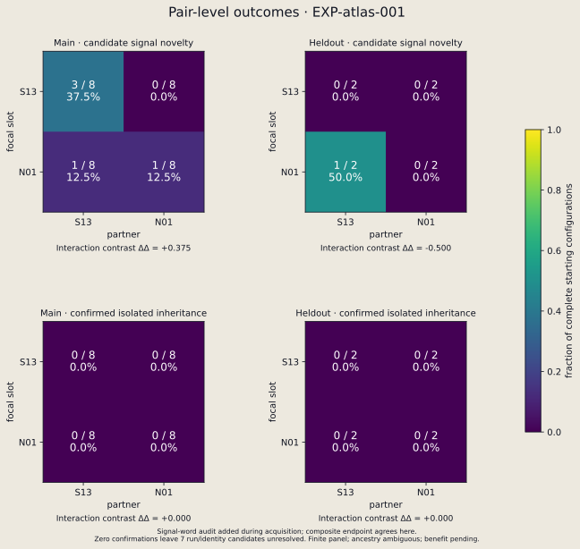
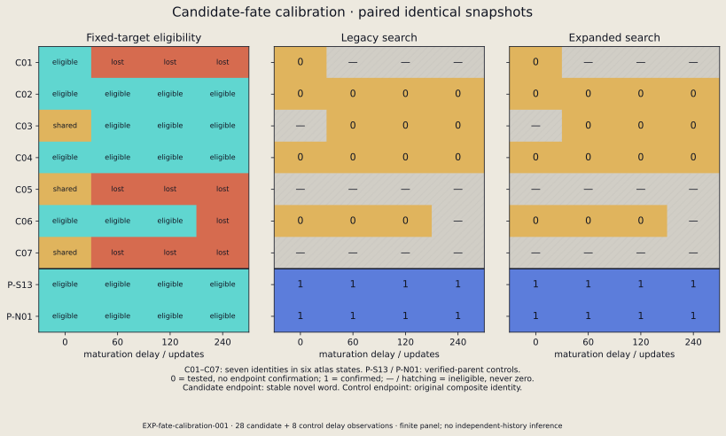

# Evoloop Levels

## Where Does Evolvability Reside? Organisms, Encounters, and Ecological History in Self-Reproducing Cellular Automata

### Abstract

Evolution depends on variation that survives reproduction. In evoloops, digital organisms reproduce within a cellular grid, and their encounters can change the structures they produce. This project investigates how organisms, their interaction partners, and ecological history contribute to the capacity to generate heritable variation. Our first study crosses two organism types under controlled encounter conditions and follows the resulting changes through reproduction tests. Six of 40 contacting configurations produced candidate changes, compared with none in 64 controls. Neither the initial inheritance test nor a broader follow-up recovered a stable novel variant; the follow-up recovered the known input organisms in all eight control states. These results distinguish the production of candidate variation from its demonstrated transmission and motivate experiments on which organisms and encounters connect the two.

*A recorded world from the exploratory simulation. Loops grow, reproduce, and encounter other structures under the same local rules. [Watch the simulation](figures/world-overview.webp). This overview illustrates the experimental system; the controlled comparisons are reported below.*

[Working paper](paper/manuscript.md) · [Paper PDF](paper/manuscript.pdf) · [Reproduce the results](docs/reproducing-results.md)

## Why study encounters?

An evoloop contains circulating signals that guide the construction of another loop. Reproduction takes place in the same space as other organisms, so a growing structure can meet a neighbour and produce a different outcome. The local update rules remain fixed while the organisms and their relationships change.

Sayama's original work established that this system supports heritable variation and natural selection [1]. Subsequent studies showed that genetic arrangements influence colony form and mutational biases, and that ecological conditions affect evolutionary dynamics [2, 3]. These findings raise a further experimental question: **when one organism produces more heritable variation than another, how much of that difference travels with the organism, and how much depends on whom it meets?**

We approach evolvability as the capacity to generate useful heritable variation under specified conditions. Measuring it requires connecting three observations: the appearance of a changed structure, the transmission of a changed identity through reproduction, and an advantage in a stated ecological task. The completed experiments examine the first two stages. A separate ecological comparison will assess whether confirmed variants improve persistence and recolonization. The distinction between replication and reproduction with inherited variation is developed in the recent review [4].

## Three linked research questions

The research programme separates contributions by changing one part of an encounter while holding another fixed. These contributions can coexist: an inherited property may be expressed only with certain partners, and ecological history may change both the property and the partners available.

| Question | Comparison | What the comparison would establish |
|---|---|---|
| **Organisms (H1): do evolved organisms retain an increased capacity under shared conditions?** | Compare organisms sampled from independently evolved populations with their ancestors in the same held-out encounter panel. | Whether evolved organisms retain higher beneficial-heritable-variant yield than their ancestors when partners and encounter conditions are shared. |
| **Encounters (H2): does a particular pairing matter?** | Exchange partners in a crossed design and compare outcomes across additional positions and reproduction phases. | Whether the effect of changing an organism depends on its partner, and whether that pattern transfers to new encounters. |
| **Ecological history (H3): how does the past shape future variation?** | Put history-derived organisms into common encounters, and common organisms into history-derived encounter distributions. | How historical effects are carried through inherited organism states, encounter opportunities, or their interaction. |

The present empirical study develops the encounter comparison and tests the inheritance of its candidate variants. The organism and history transplants extend this design to the other two questions. In this deterministic system, history acts through the states and conditions it produces; identical complete states with identical future interventions have identical futures.

## Experimental approach

We use the original synchronous, nine-state evoloop rules. The input organisms are **S13**, a documented seed, and **N01**, a stable descendant recovered through an exploratory sequence of isolation and reproduction. N01 gives us a second verified organism with which to exchange partners.

The encounter panel contains all four ordered S13/N01 pairings. Each pairing is tested in eight main configurations and two held-out configurations, varying relative geometry, orientation, and elapsed development time. All 40 nearby configurations make contact during the 1,600-update observation window. Another 40 configurations place the same inputs farther apart, and 24 grow the organisms alone. The separated controls use a larger grid; they test the declared no-contact conditions, rather than changing distance alone.

A candidate is a newly detected loop whose operational identity differs from both inputs. The recorded identity combines its circulating signal sequence and core dimensions. A subsequent reporting audit established that all seven candidate identities also differ in signal sequence; this stricter reading was added after the original definition was fixed.

To test inheritance, we move a complete separable structure, including its growing arms, into an empty world. We then follow detached descendants and require repeated transmission of a stable identity. A transient candidate can qualify by first producing a different, stable descendant. This intervention tests reproduction after separation from the encounter; it can also change the conditions a candidate needs to reproduce.

After the initial tests recovered no stable novel identity, a follow-up examined two explanations: candidates might need more time before extraction, or the initial search might miss a successful descendant. It therefore tested delays of 0, 60, 120, and 240 updates and compared the original search with a broader descendant search on identical eligible snapshots. Known S13 and N01 states served as positive controls.

## Results

### Encounters produced candidate variation

| Configuration group | Configurations observed | Configurations producing candidates |
|---|---:|---:|
| Contacting pairs | 40 | 6 |
| Separated pairs | 40 | 0 |
| Organisms alone | 24 | 0 |

The six contacting configurations produced seven candidate identities. Five configurations supplied 11 isolatable snapshots; the sixth supplied no separable candidate within the observation window. None of the 11 tested paths met the stable-inheritance criterion.

Candidate production also depended on which inputs were paired. However, the partner-dependent ranking in the main configurations changed in the held-out configurations:

| Focal organism × partner | Main configurations producing candidates | Held-out configurations producing candidates |
|---|---:|---:|
| S13 × S13 | 3/8 | 0/2 |
| S13 × N01 | 0/8 | 0/2 |
| N01 × S13 | 1/8 | 1/2 |
| N01 × N01 | 1/8 | 0/2 |

In the main panel, S13×S13 configurations produced candidates more often than N01×S13, whereas S13×N01 produced fewer than N01×N01. That reversal did not persist in the held-out panel, and neither panel yielded confirmed stable novel inheritance. The observed ranking therefore concerns candidate production in the main configurations, rather than a transferable ranking of evolvability.

*Candidate production and confirmed inheritance are shown separately. Counts refer to the specified configurations, not independent evolutionary populations. [Complete encounter analysis](data/atlas/analysis.md).*

### More time and a broader search did not recover the tested candidates

The follow-up revisited all seven candidate identities at four delays, yielding 28 observations. Fifteen contained an eligible separable structure, ten had lost the tracked core, and three remained joined to other structures. The latter 13 observations could not enter the paired isolation comparison.

| Structures assessed | Eligible observations | Stable novel identity: original search | Stable novel identity: broader search |
|---|---:|---:|---:|
| Encounter candidates | 15 of 28 | 0/15 | 0/15 |

For the positive controls, the endpoint was recovery of the **original** identity. Both searches recovered it in **8/8 states**: two known organisms assessed at four delays each.

*The two searches assess the same extracted structures. Delay observations revisit candidates from six originating configurations; they are not independent populations. [Complete follow-up analysis](data/fate-calibration/analysis.md).*

## What these findings mean

The completed comparisons reveal a gap between producing a changed structure and recovering a new identity that reproduces stably. The follow-up makes that result more informative: the procedures recovered the known organisms across the tested delays, while giving the eligible candidates additional development time and descendant-search opportunities did not produce a confirmed novel lineage. Thus the initial result persists under these specific changes to the inheritance test.

Several explanations remain compatible with the evidence. The tested pairings may usually produce changes that fail to stabilize; successful paths may occur beyond the observed phases and descendants; or isolation may remove ecological conditions needed for reproduction. Recovery of the two known organisms establishes that the procedures can recover those forms, while the unresolved candidate states limit generalization to other forms. Structural observations in continued native worlds also have boundary and ancestry limitations, so they do not settle the ecological fate of every candidate.

The next encounter study will broaden the input panel with naturally generated, separately verified organisms and use fresh encounter configurations. This comparison asks whether recovery of stable novelty depends on the original S13/N01 pairing set. The [experimental extension](docs/next-experiment.md) connects that step to the organism and ecological-history transplants. A subsequent benefit assay will compare confirmed variants with their inputs under specified disturbances.

The longer-term question is whether evolutionary change alters the capacity for further adaptive change. The route to answering it is to measure the production, transmission, and ecological consequences of variation together, then determine which differences transfer with organisms and which depend on their encounters.

## Reproduce and explore

The repository includes complete starting states, compact outcome data, experiment protocols, analysis scripts, and figure sources. [Reproduction instructions](docs/reproducing-results.md) cover installation, analysis, replay, and fresh runs. The [working paper](paper/manuscript.md) gives the full methods and interpretation; [source notes](docs/source_review.md) document the model and literature.

Visualizations use the shared [Chromatic Fields configuration](configs/style.json) and recorded cell states. [Encounter replays](figures/encounter-1.webp), [an exploratory inheritance path](figures/inheritance-path-light.svg), and [raw-state comparisons](figures/fate-raw-comparison-light.svg) make individual events inspectable. The [figure manifest](figures/manifest.json) links each image to its evidence and regeneration command.

## References

1. Sayama, H. (1999). *A New Structurally Dissolvable Self-Reproducing Loop Evolving in a Simple Cellular Automata Space*. Artificial Life, 5(4), 343–365. [Paper](https://bingdev.binghamton.edu/sayama/papers/ALIFE5-4-343.pdf).
2. Salzberg, C., & Sayama, H. (2004). *Complex Genetic Evolution of Artificial Self-Replicators in Cellular Automata*. Complexity, 10(2), 33–39. [Paper](https://bingdev.binghamton.edu/sayama/papers/Complexity-preprint.pdf).
3. Salzberg, C., Antony, A., & Sayama, H. (2004). *Evolutionary Dynamics of Cellular Automata-Based Self-Replicators in Hostile Environments*. BioSystems, 78(1–3), 119–134. [Paper](https://bingdev.binghamton.edu/sayama/papers/BioSystems-preprint.pdf).
4. Sayama, H., & Nehaniv, C. L. (2025). *Self-Reproduction and Evolution in Cellular Automata: 25 Years After Evoloops*. Artificial Life, 31(1), 81–95. [Preprint](https://arxiv.org/abs/2402.03961v2).
