# Evoloop Levels

## Where Does Evolvability Reside? Organisms, Encounters, and Ecological History in Self-Reproducing Cellular Automata

### Abstract

Evoloops reproduce within a cellular grid, where encounters can change the structures they produce. We investigate how organisms, their partners and ecological history contribute to useful heritable variation. An initial two-organism atlas produced candidates in 6/40 contacting configurations without confirmed stable novelty. A prospective three-identity atlas confirmed pair-relative inherited novelty in 2/36 main and 0/18 held-out encounters: one catalogue-novel word and one recovery of a known third identity. Candidate rank reversals did not transfer held out. A first population-score advantage had mostly no-op disturbances and symmetry-equivalent reserved challenges; a subsequent matched-removal assay found no joint superiority over both originating inputs. Coverage then demonstrated that this registry score omits recoverable source states, while failing a state-specific recovery gate. A new prospective source measure qualified in 20 calibration worlds and was applied to a fully crossed comparison of preparation age and spatial layout. All 160 worlds are complete, confirming 5,470 of 6,250 detected source observations while retaining 780 unresolved. Sixteen absolute disturbed-count age contrasts and two development interactions exclude zero within the declared envelopes; every relative retention age and interaction interval includes zero. Neither recovered state meets the joint criterion, although RV01 exceeds both inputs in absolute disturbed count in confirmation alone. These finite comparisons distinguish variation production, transmission, population abundance and paired retention. Isolated recoverability does not establish total viable population. Independent organism and ecological-history transplants remain necessary for H1 and H3; increased evolvability and recursive self-improvement are not established.

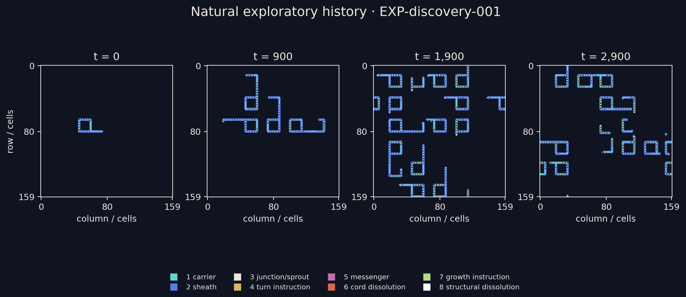

*A recorded world from the exploratory simulation. Loops grow, reproduce, and encounter other structures under the same local rules. [Watch the simulation](figures/world-overview.webp). This overview illustrates the experimental system; the controlled comparisons are reported below.*

[Working paper](paper/manuscript.md) · [Paper PDF](paper/manuscript.pdf) · [Reproduce the results](docs/reproducing-results.md)

## Why study encounters?

An evoloop contains circulating signals that guide the construction of another loop. Reproduction takes place in the same space as other organisms, so a growing structure can meet a neighbour and produce a different outcome. The local update rules remain fixed while the organisms and their relationships change.

Sayama's original work established that this system supports heritable variation and natural selection [1]. Subsequent studies showed that genetic arrangements influence colony form and mutational biases, and that ecological conditions affect evolutionary dynamics [2, 3]. These findings raise a further experimental question: **when one organism produces more heritable variation than another, how much of that difference travels with the organism, and how much depends on whom it meets?**

We approach evolvability as the capacity to generate useful heritable variation under specified conditions. Measuring it requires connecting three observations: the appearance of a changed structure, the transmission of a changed identity through reproduction, and an advantage in a stated ecological task. The completed experiments test transmission and compare both inherited outcomes under a calibrated ecological population proxy. The first comparison reveals a finite score advantage with limited disturbance exposure; the subsequent matched-removal comparison finds no joint-confirmed advantage over both inputs. A subsequent coverage assay recovers stable registered descendants from six of eight selected unknown-identity sources, while failing one state-specific recovery threshold. These outcomes make performance definition and score coverage part of the scientific question. The distinction between replication and reproduction with inherited variation is developed in the recent review [4].

## Three linked research questions

The research programme separates contributions by changing one part of an encounter while holding another fixed. These contributions can coexist: an inherited property may be expressed only with certain partners, and ecological history may change both the property and the partners available.

| Question | Comparison | What the comparison would establish |
|---|---|---|
| **Organisms (H1): do evolved organisms retain an increased capacity under shared conditions?** | Compare organisms sampled from independently evolved populations with their ancestors in the same held-out encounter panel. | Whether evolved organisms retain higher beneficial-heritable-variant yield than their ancestors when partners and encounter conditions are shared. |
| **Encounters (H2): does a particular pairing matter?** | Exchange partners in a crossed design and compare outcomes across additional positions and reproduction phases. | Whether the effect of changing an organism depends on its partner, and whether that pattern transfers to new encounters. |
| **Ecological history (H3): how does the past shape future variation?** | Put history-derived organisms into common encounters, and common organisms into history-derived encounter distributions. | How historical effects are carried through inherited organism states, encounter opportunities, or their interaction. |

The present empirical study develops the encounter comparison and tests the inheritance of its candidate variants. The organism and history transplants extend this design to the other two questions. In this deterministic system, history acts through the states and conditions it produces; identical complete states with identical future interventions have identical futures.

## Experimental approach

We use the original synchronous, nine-state evoloop rules. The input organisms are **S13**, a documented seed, and **N01**, a stable descendant recovered through an exploratory sequence of isolation and reproduction. N01 gives us a second verified organism with which to exchange partners.

The encounter panel contains all four ordered S13/N01 pairings. Each pairing is tested in eight main configurations and two held-out configurations, varying relative geometry, orientation, and elapsed development time. All 40 nearby configurations make contact during the 1,600-update observation window. Another 40 configurations place the same inputs farther apart, and 24 grow the organisms alone. The separated controls use a larger grid; they test the declared no-contact conditions, rather than changing distance alone.

A candidate is a newly detected loop whose operational identity differs from both inputs. The recorded identity combines its circulating signal sequence and core dimensions. A subsequent reporting audit established that all seven candidate identities also differ in signal sequence; this stricter reading was added after the original definition was fixed.

To test inheritance, we move a complete separable structure, including its growing arms, into an empty world. We then follow detached descendants and require repeated transmission of a stable identity. A transient candidate can qualify by first producing a different, stable descendant. This intervention tests reproduction after separation from the encounter; it can also change the conditions a candidate needs to reproduce.

After the initial tests recovered no stable novel identity, a follow-up examined two explanations: candidates might need more time before extraction, or the initial search might miss a successful descendant. It therefore tested delays of 0, 60, 120, and 240 updates and compared the original search with a broader descendant search on identical eligible snapshots. Known S13 and N01 states served as positive controls.

The fresh comparison uses three distinct naturally generated channel identities, selected before their encounter outcomes were observed. Each input word survived stabilization and two further isolated transmissions. Nine ordered pairings are assessed in four main and two held-out configurations each, alongside matched separated and solitary controls. All 144 arenas share a 640×640 periodic domain; paired controls change only partner distance. Unlike the original atlas, this comparison prospectively screens for words different from both inputs and applies the broader descendant search with validated periodic recognition. The two atlases therefore have separate conditional endpoints.

## Results

### Encounters produced candidate variation

| Configuration group | Configurations observed | Configurations producing candidates |
|---|---:|---:|
| Contacting pairs | 40 | 6 |
| Separated pairs | 40 | 0 |
| Organisms alone | 24 | 0 |

The six contacting configurations produced seven candidate identities. Five configurations supplied 11 isolatable snapshots; the sixth supplied no separable candidate within the observation window. None of the 11 tested paths met the stable-inheritance criterion.

Candidate production also depended on which inputs were paired. However, the partner-dependent ranking in the main configurations changed in the held-out configurations:

| Focal organism × partner | Main configurations producing candidates | Held-out configurations producing candidates |
|---|---:|---:|
| S13 × S13 | 3/8 | 0/2 |
| S13 × N01 | 0/8 | 0/2 |
| N01 × S13 | 1/8 | 1/2 |
| N01 × N01 | 1/8 | 0/2 |

In the main panel, S13×S13 configurations produced candidates more often than N01×S13, whereas S13×N01 produced fewer than N01×N01. That reversal did not persist in the held-out panel, and neither panel yielded confirmed stable novel inheritance. The observed ranking therefore concerns candidate production in the main configurations, rather than a transferable ranking of evolvability.

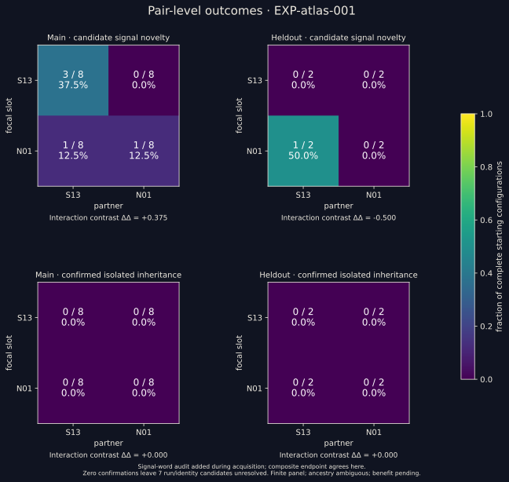

*Candidate production and confirmed inheritance are shown separately. Counts refer to the specified configurations, not independent evolutionary populations. [Complete encounter analysis](data/atlas/analysis.md).*

### More time and a broader search did not recover the tested candidates

The follow-up revisited all seven candidate identities at four delays, yielding 28 observations. Fifteen contained an eligible separable structure, ten had lost the tracked core, and three remained joined to other structures. The latter 13 observations could not enter the paired isolation comparison.

| Structures assessed | Eligible observations | Stable novel identity: original search | Stable novel identity: broader search |
|---|---:|---:|---:|
| Encounter candidates | 15 of 28 | 0/15 | 0/15 |

For the positive controls, the endpoint was recovery of the **original** identity. Both searches recovered it in **8/8 states**: two known organisms assessed at four delays each.

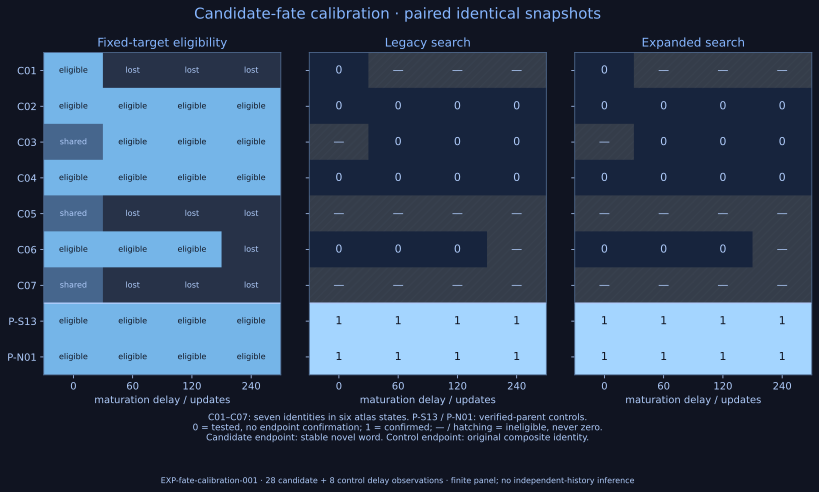

*The two searches assess the same extracted structures. Delay observations revisit candidates from six originating configurations; they are not independent populations. [Complete follow-up analysis](data/fate-calibration/analysis.md).*

### Fresh encounters recover two stable pair-relative outcomes

A frozen discovery schedule has now verified three distinct naturally generated channel identities. V01 is the reverified N01 word. The native sources of V02 and V03 were first observed in an N01×N01 history at sampled updates 3,440 and 5,040, then each stabilized from a 12×14 to a 13×13 core while transmitting its changed word through two further isolated generations. The two new identities share core dimensions but carry different channel words.

All 79 verification trials are retained: three identities passed, 74 remained unresolved or changed identity during the transmission chain, and two reproduced a word different from their native source. These selected trials assemble inputs; they do not estimate encounter yield or provide independent population histories. The completed fresh atlas has 144 distinct starting states: 54 near configurations, 54 separated controls, and 36 solitary controls. All near configurations contact; none of the separated controls do.

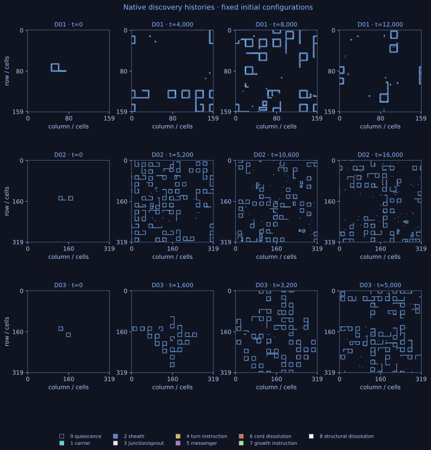

*Recorded cell states under the unchanged rule; isolation verification supplies the viable input identities. [Discovery protocol](protocols/005-natural-panel-discovery.md) and [complete evidence](data/panel-v2/discovery.json).*

| Fresh panel | Candidate-producing configurations | Confirmed pair-relative inheritance |
|---|---:|---:|
| Main encounters | 14/36 | 2/36 |
| Held-out encounters | 4/18 | 0/18 |
| Separated controls | 0/54 | 0/54 |
| Solitary controls | 0/36 | 0/36 |

The successful states are V01×V03 and V02×V03 in the parallel geometry at offset 20. V01×V03 yields a 14×14 stable identity whose word differs from all three catalogue inputs. V02×V03 recovers V01's known 12×12 identity, which differs from its two inputs and qualifies under the frozen pair-relative definition. Thus supplementary catalogue-relative yield is 1/36 main and 0/18 held out. Both stable words are observed natively and transmit repeatedly after isolation; parentage within the original pair remains ambiguous.

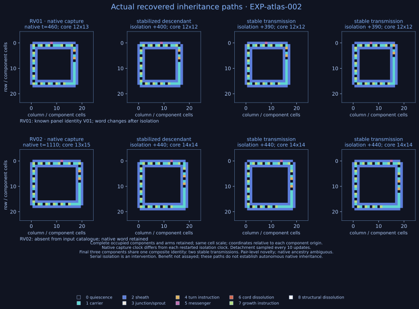

*Transient candidates, complete extracted components, and stable isolated descendants from actual recorded states. Eight successful roots converge on two identities from two configurations; they are not eight independent events. [Fresh encounter analysis](data/atlas-v2/analysis.md), [joined outcomes](data/atlas-v2/outcomes.csv), and [independent interpretation audit](docs/scientific_review.md).*

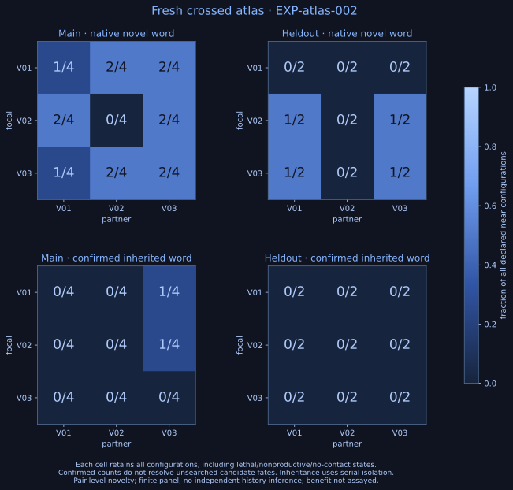

*Candidate and inherited outcomes retain every declared configuration in their denominators. Main candidate rank reversals do not persist held out; inherited main differences also disappear held out. [Candidate and inheritance stages, with the original pending-benefit status](figures/atlas2-evidence-stages-dark.svg) and [annotated replay](figures/atlas2-encounter-1.webp).*

The isolation search evaluates 88 roots from 52 run/composite candidate identities, executing 1,205 generation simulations. Six identities have no extractable phase. Simulation-budget and depth limits leave 158 recorded truncations, and 441 nodes reach the three-offspring collection cap. Unrecovered candidates and later branches remain unresolved. Both recovered stable outcomes proceed to a frozen ecological comparison; the other 16 candidate-producing encounters retain unresolved inheritance outcomes.

### Ecological calibration passes; independent benefit confirmation remains unresolved

The frozen score counts closed cores from four verified composite identities, rather than all viable organisms. Calibration recovers the original identity from **63/68 selected scored components (92.6%)** and **5/5 baseline controls**, passing every frozen gate. Five sampled components do not confirm recovery: three isolated grids become empty and two remain nonempty without qualifying reproduction; their original identities recur natively without established ancestry. No unscored cores are selected, so sensitivity to viable identities outside the registry remains untested.

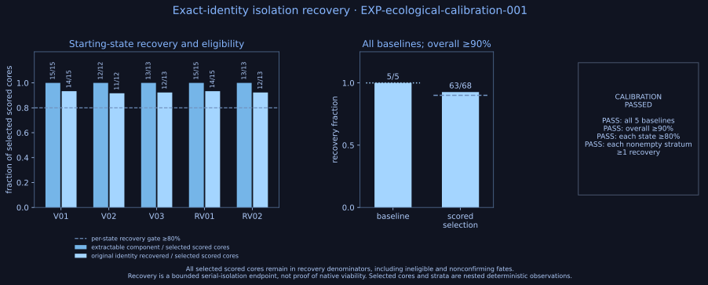

*Selected components are nested observations within ten deterministic ecologies. Passing recovery thresholds validates the sampled proxy, not every native body's reproductive fate. [Stratum-level recovery](figures/eco1-calibration-strata-dark.svg) and [calibration analysis](data/ecological-v1/calibration-analysis.json) retain the denominators.*

All 20 frozen paired state-condition runs complete. Unregistered valid and unknown-identity cores occur briefly in these worlds; their viability is untested and they remain outside the fixed score. Each candidate is compared with **both** originating inputs. The mean is registered-core population over 162 equally weighted samples per two-condition panel; development and reserved confirmation have identical means:

| Inherited candidate | Candidate mean | Originating input means | Frozen finite criterion |
|---|---:|---|---|
| RV01: recovered V01 identity | 3.580 | V02: 3.370; V03: 3.321 | Met |
| RV02: new 14×14 identity | 3.136 | V01: 3.562; V03: 3.321 | Not met |

The formal proxy-criterion yield is **1/36 main encounters, 0/18 held out, and 1/54 overall**. The successful state recovers a known catalogue word; the catalogue-novel word does not meet the criterion. The other 16 candidate-producing encounters remain unresolved. RV01 and V01 have the same composite identity but different complete prepared states, so performance differences cannot be assigned solely to genotype.

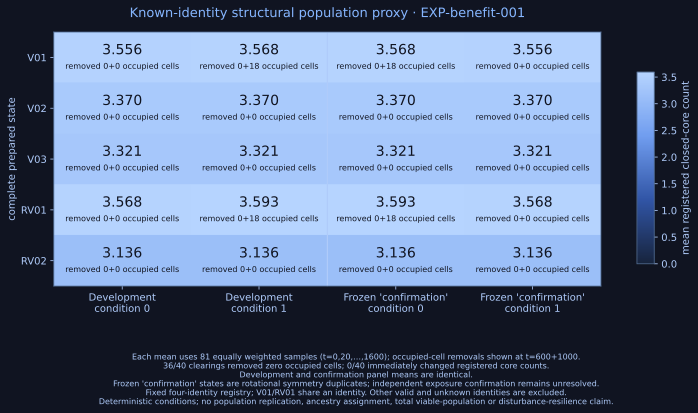

*The score is conditional on the fixed identity registry and 1,600-update horizon. [Both-input margins](figures/eco1-paired-margins-dark.svg) retain the strict arithmetic; [measurement stages](figures/eco1-evidence-stages-dark.svg) distinguish inherited outcomes, the finite proxy criterion, and unresolved independent ecological benefit.*

**Independent ecological benefit confirmation remains unresolved.** Of 40 scheduled clearings, 36 remove no occupied cells; four remove 18 cells each without immediately reducing the counted population. An independent symmetry audit shows that the reserved confirmation trajectories duplicate development under rotation and periodic centering translations. They provide no new ecological challenge. Without effective measured depletion or paired undisturbed controls, the result does not demonstrate recolonization or general ecological superiority.

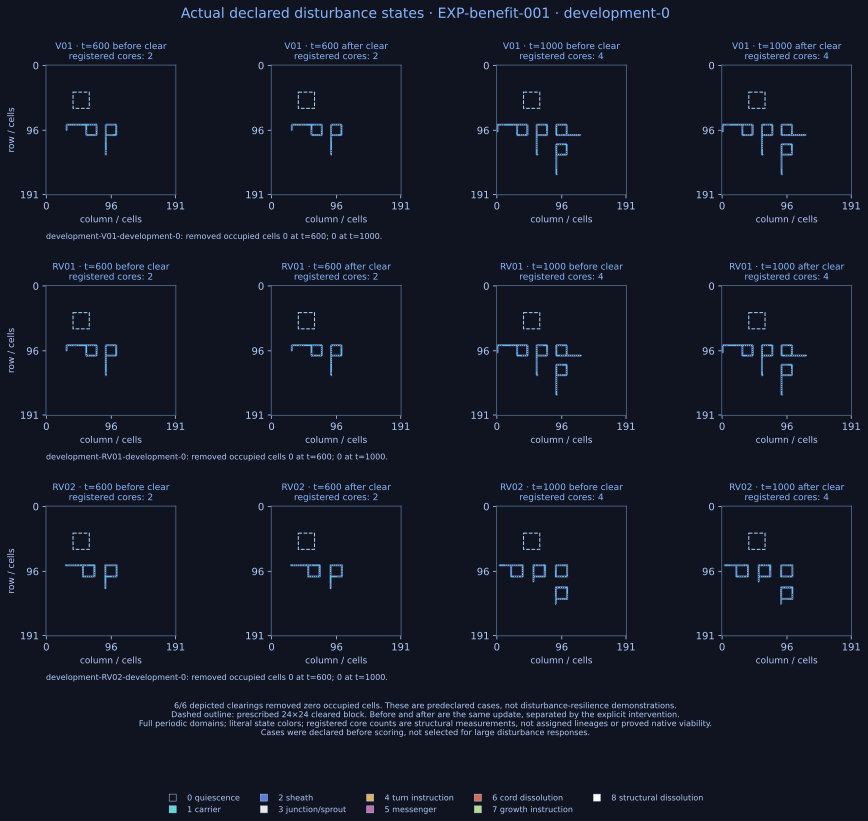

*Actual cell states and disturbance impacts remain visible, including zero-impact clearings. Recorded animations show the predeclared development-0 condition for [V01](figures/eco1-disturbance-V01.webp), [RV01](figures/eco1-disturbance-RV01.webp), and [RV02](figures/eco1-disturbance-RV02.webp); both scheduled blocks remove zero occupied cells in each of these runs. [Complete paired analysis](data/ecological-v1/analysis.md) preserves the frozen classification; the [scientific review](docs/scientific_review.md) explains its scope and the symmetry limitation.*

### Matched loss and paired baselines change the performance comparison

A subsequent prospective assay constructs standardized microcolonies from three identical complete copies of each prepared organism state. These are imposed ecologies, rather than native historical transplants. At update zero, removing one full component takes **one third of occupied cells and one of three registered cores**, leaving the other copies unchanged. All six declared preparation ages and nonsymmetric geometries are frozen before disturbed futures are observed. Reserved complete states pass rotation/translation non-equivalence checks. Each disturbed state has an undisturbed control; all **40 paired worlds** complete.

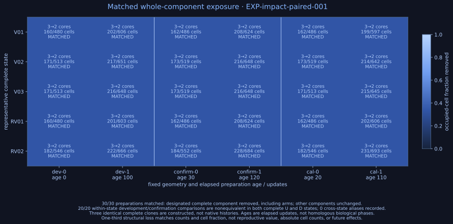

*Arms remain intact in the two surviving copies. Fractional structural impact is exact, while absolute removed cells and reproductive value can differ. [Score calibration](figures/impact1-calibration-dark.svg) recovers the original identity from 77/80 selected scored components (96.25%) and 30/30 isolated age controls. Three nonconfirming roots become empty after isolation; native ancestry and lineage survival remain unresolved.*

Retention compares disturbed with undisturbed population within each condition, then averages the two exact ratios in each panel. The joint criterion also requires larger absolute disturbed population than **both** originating inputs in **both** panels:

| State | Retention: development | Retention: confirmation | Disturbed mean: development | Disturbed mean: confirmation |
|---|---:|---:|---:|---:|
| V01 | 0.7430 | 0.6410 | 6.2037 | 6.0741 |
| V02 | 0.8272 | 0.9147 | 6.3395 | 6.6914 |
| V03 | 0.7337 | 0.6964 | 5.6358 | 5.4568 |
| RV01 | 0.7442 | 0.6409 | 6.2654 | 6.1235 |
| RV02 | 0.6772 | 0.6855 | 4.9321 | 5.1852 |

Neither inherited state meets the relative or absolute criterion against both inputs in both panels. Conditional joint-confirmed originating encounters are **0/36 main, 0/18 held out, and 0/54 overall** for this assay, with sixteen other candidate encounters unresolved. This does not establish zero true beneficial variation or universal inferiority. The earlier frozen proxy classification remains 1/54 under its different preparation and criterion.

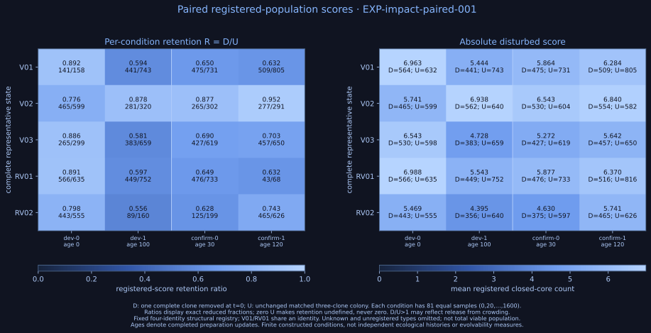

*Fixed-registry cores define the population score. [Panel-mean contrasts](figures/impact1-contrasts-dark.svg) compare each candidate with both inputs. [Per-condition contrasts](data/impact-v1/contrasts.md) reveal changes hidden by those means: RV01 exceeds V02 in development-0 retention by 0.1150, then falls below it by 0.2811 in development-1. Age and geometry change together, preventing attribution to either alone. [Paired trajectories](figures/impact1-paired-curves-dark.svg) retain the predeclared configurations.*

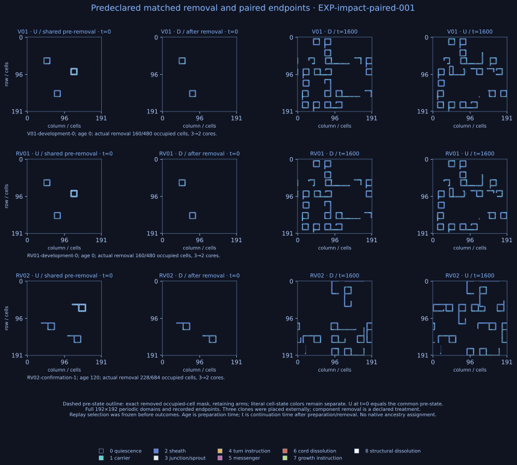

*Every grid depicts recorded cell states. Predeclared disturbed/undisturbed replays cover [V01 development-0](figures/impact1-paired-V01-development-0.webp), [RV01 development-0](figures/impact1-paired-RV01-development-0.webp), and [RV02 confirmation-1](figures/impact1-paired-RV02-confirmation-1.webp). [Complete analysis](data/impact-v1/analysis.md) and [exact contrasts](data/impact-v1/contrasts.md) preserve the arithmetic and denominators.*

At this stage, reproduction of the excluded valid unregistered and unknown-identity cores had not been assayed. V02's undisturbed development-1 world averages 0.852 valid unregistered cores per sample. No such cores are selected at the separate calibration source times, so that passing gate does not establish full coverage of the paired worlds.

## Does the population score omit recoverable structures?

[Protocol 010](protocols/010-paired-world-score-coverage.md) follows all 40 paired worlds and selects the first core in each of three classes at updates 400, 800, and 1200, before extraction filtering. It tests complete components, including arms, after native delays of 0, 100, and 400 updates. Stable recovery requires a descendant identity to persist through two consecutive transmissions. The 360 declared strata contain 137 selected source observations; 223 are empty. Shared components, sampled target losses, and capped searches remain explicit.

| Source class | Stable recovery / selected sources, any delay | Confirmed / extractable / planned delay assays |
|---|---:|---:|
| Registry-scored | 118/120 | 315/337/360 |
| Valid unregistered identity | 0/9 | 0/11/27 |
| Unknown source identity | **6/8** | **14/14/24** |

Six unknown-identity sources recover stable registered descendants, all already at delay zero. They are three pairs of byte-identical complete isolation inputs from disturbed and undisturbed worlds, rather than six independent organisms or histories. Their source identity is unknown; the recovered identity does not retrospectively identify that source or establish native parentage. This demonstrates that the score excludes source states capable of stable descendant production after isolation. It does not measure total viable population or ecological benefit.

The zero stable recoveries from valid unregistered sources do not establish nonviability. Three sources produce detached known-identity offspring in nine searches, all of which reach the 24-simulation cap without confirming stable transmission. Other paths remain unresolved or ineligible. All 17 omitted source cores later disappear at their original coordinates; this does not establish lineage extinction.

The frozen recovery gate **fails**: all 30 preparation controls pass and scored delay-zero recovery is 109/120 overall, but RV02 recovers only 18/24, below its required 80%. The 118/120 union over delays cannot replace that gate. Thus these are diagnostic existence findings, with incomplete calibration for broader comparisons. Earlier population scores and ecological classifications remain unchanged.

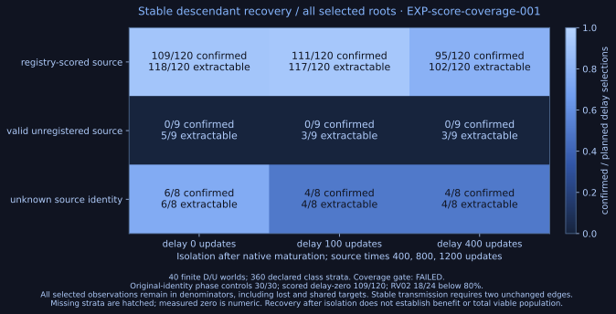

*Stable confirmation and extractability use different denominators. [State-level source unions](figures/coverage1-state-unions-dark.svg) retain empty strata. [Recorded native states](figures/coverage1-native-targets-dark.svg) distinguish coordinate loss from lineage fate; [three recovered paths](figures/coverage1-inheritance-dark.svg) show the complete unknown source components and their stable descendants. [Coverage analysis](data/coverage-v1/analysis.md) retains bounded unresolved outcomes.*

## How recoverable developmental states enter the measure

The new prospective measure counts **Q**, source bodies that produce any stable descendant identity under complete-component isolation, even when their source genotype is unknown. **C** counts every detected core, and **R=C−Q** retains unresolved sources, including shared components and bounded nonconfirming searches. Each source contributes at most one to Q. The envelope [Q,C] concerns potentially recoverable detected bodies under this assay, not total viable population or native parentage. Five source censuses at updates 0, 400, 800, 1200, and 1600 are retained separately from the old registry score.

The prospective developmental source calibration completes all 20 new worlds and 100 census snapshots. It confirms Q=736 of C=820 detected source observations, retaining R=84 unresolved: 74 nonconfirming source observations and 10 shared components. All 30 original-identity phase controls and 3 known omitted-input controls pass. Registry-scored sources recover 726/799 (90.86%); each state's scored share exceeds 80%, including RV02 at 116/127. All ten state×treatment resolved shares exceed 4/5; the lowest is RV01-U at 95/113. Thus the new finite-context gate passes. Independent native and isolation replay verifies the complete census, transmissions and exact gates with zero mismatches. It does not replace protocol 010's failed gate, whose contexts, selection and source times differ.

| Source class | Confirmed Q | Unresolved R | Detected C |
|---|---:|---:|---:|
| Registry-scored | 726 | 73 | 799 |
| Valid unregistered | 0 | 9 | 9 |
| Unknown source identity | 10 | 2 | 12 |
| All detected sources | 736 | 84 | 820 |

The ten unknown-source confirmations are five bodies in each twin of V01 calibration-0 at update 1600. All ten have one byte-identical complete isolation input and recover the registered V01/RV01 identity. Their multiplicity belongs in the source counts but does not provide ten independent recovery demonstrations. Their source genotype remains unknown. No stable recovery occurs for nine valid-unregistered observations; three produce offspring while remaining bounded unresolved. Across all classes, 59 source observations reference isolated root extinction, 9 no offspring before the generation horizon, and 6 productive unresolved paths. These 74 nonconfirming observations reference 34 distinct complete search inputs. They are isolation outcomes, not identified native lineage deaths or proof of nonviability. No local 128-key cap is exhausted. The assay executes 530 generation simulations across 240 distinct complete-input/search keys, including repeated controls.

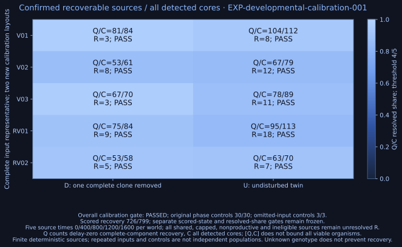

*All detected sources remain in Q/C; unresolved R stays explicit. [Complete recorded paired states](figures/developmental1-paired-states-dark.svg) show the first declared illustration condition. [Analysis](data/developmental-v1/analysis.md), [protocol 011](protocols/011-developmental-source-measure.md), and [crossed protocol 012](protocols/012-crossed-age-geometry.md) preserve the definitions and exact gates. The completed crossed assessment below applies the frozen measure to all 160 worlds/80 pairs.*

## Separating preparation age from the spatial challenge

The matched-removal assay changed preparation age and layout together. A sign change could therefore arise from either change or their interaction. Protocol 012 crosses ages 0, 30, 100 and 120 at every layout for all five complete input states, with disturbed and undisturbed twins. All 160 worlds and 800 source censuses are complete. D removes one complete clone, deleting one third of occupied cells and one third of the count in each occupied-state bin, with registered cores 3→2; U retains all three clones. The reserved complete starts are distinct from development and previous assessment inputs under rotation and translation; 20 previously observed development starts retain their repeat labels.

The census confirms Q=5,470 of C=6,250 source observations, retaining R=780 unresolved. Class-specific recovery is 5,418/6,048 registry-scored, 4/124 valid-unregistered and 48/78 unknown-identity. All 30 original-identity phase controls and three known omitted-input controls pass. The frozen new-context calibration remains passed; the earlier coverage gate remains failed. Main-world registry recovery is below the numerical 90% threshold used in that calibration. Protocol 012 uses the prior frozen calibration as its gate; passing it does not establish main-world coverage, and the threshold is not retroactively reapplied. The low valid-unregistered resolution contributes broad envelopes. These are source observations nested within deterministic worlds, not distinct organisms or independent populations.

Each retention interval uses five-census sums [Q_D/C_U,C_D/Q_U]. The panel means below average eight condition intervals rather than pooling counts. Disturbed means average the corresponding five-census [Q,C] counts. Display values are rounded; [the analysis](data/crossed-v1/analysis.md) preserves exact fractions and all 80 conditions.

| State | Panel | Retention envelope | Disturbed source-count mean [Q,C] |
|---|---|---:|---:|
| V01 | development | [0.6719, 0.9035] | [6.5250, 7.2750] |
| V01 | confirmation | [0.6776, 0.9509] | [7.1750, 8.3250] |
| V02 | development | [0.7294, 1.0631] | [5.9750, 7.0500] |
| V02 | confirmation | [0.5922, 0.7876] | [4.8250, 5.5250] |
| V03 | development | [0.6943, 0.7977] | [5.7000, 5.9250] |
| V03 | confirmation | [0.7725, 0.8867] | [6.9000, 7.1750] |
| RV01 | development | [0.6821, 0.8767] | [6.6250, 7.2750] |
| RV01 | confirmation | [0.6948, 0.9015] | [7.3250, 8.3250] |
| RV02 | development | [0.5997, 0.7875] | [4.1000, 4.6500] |
| RV02 | confirmation | [0.7235, 0.9723] | [5.3500, 6.0500] |

Neither RV01 nor RV02 meets relative superiority over both originating inputs in both panels. RV01 exceeds both inputs in absolute disturbed count in confirmation alone: its Q mean is 7.325, compared with input C means 5.525 and 7.175. Its development comparison and relative criteria remain unmet. RV02 meets neither robust criterion across panels. Joint-confirmed originating-encounter fractions are therefore 0/36 main, 0/18 held out and 0/54 overall under this assay. Sixteen other candidate-producing encounters retain unresolved inheritance. Overlapping bounds and unconfirmed pathways do not establish zero true benefit.

| Measure | Contrast | Positive | Negative | Includes zero |
|---|---|---:|---:|---:|
| Relative retention | Age,40 | 0 | 0 | 40 |
| Relative retention | Layout,40 | 2 | 15 | 23 |
| Relative retention | Interaction,20 | 0 | 0 | 20 |
| Absolute disturbed count | Age,40 | 16 | 0 | 24 |
| Absolute disturbed count | Layout,40 | 10 | 14 | 16 |
| Absolute disturbed count | Interaction,20 | 0 | 2 | 18 |

Positive and negative entries count exact intervals wholly above or below zero, not statistical significance. Sixteen absolute disturbed-count age contrasts exclude zero; two negative V03 development interactions are [−1.0,−0.4] for age 100−0 and [−1.8,−0.6] for 120−30. Every retention age and interaction interval includes zero. Thirteen of 20 B−A retention layout contrasts are negative; F−E has two negative, two positive and sixteen overlapping contrasts. The positive F−E comparisons concern V03 at ages 0 and 30. Thus source abundance can depend on age and layout while a change in paired retention remains unresolved. A/B and E/F are different spatial challenges, not replication of one geometry treatment. Each layout includes the removed-clone site, and elapsed ages are not homologous reproductive phases.

The four valid-unregistered confirmations occur at native update 1600 in RV02 layout B, ages 0 and 30, in both twins. Two distinct complete inputs with observed 13×14 identities recover the registered 13×13 V03 identity. Forty-eight unknown-source confirmations share two complete inputs and recover V01/RV01 or V03. These findings certify recoverable source states excluded by the fixed registry, without relabeling source genotype, assigning native parents or supplying independent recovery replicates. The remaining 780 observations include 645 nonconfirming searches and 135 shared-component exclusions. Nonconfirmation is unresolved recoverability; isolated extinction is not native lineage death.

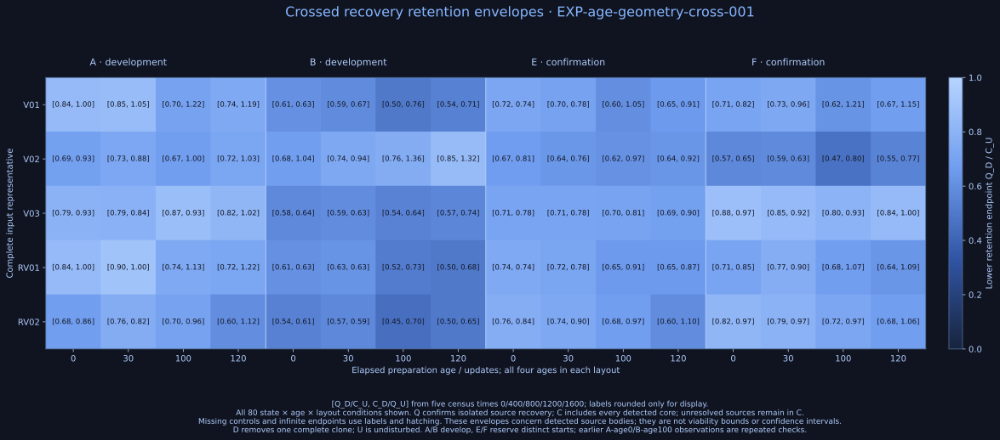

*All 80 conditions are shown before panel aggregation. Labels give [Q_D/C_U,C_D/Q_U]; color encodes the lower endpoint. Source counts use five declared census times and retain every unresolved core. These operational envelopes are not total-viability bounds or confidence intervals.*

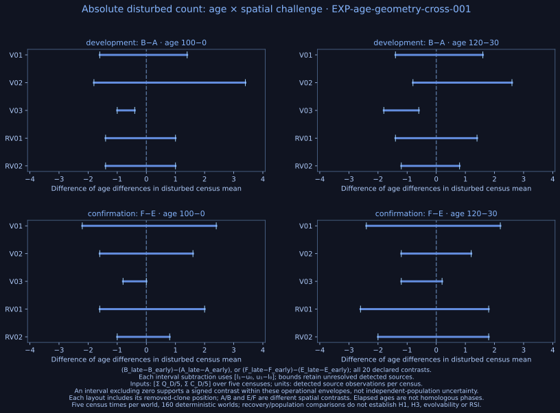

*All 20 differences of age differences in disturbed source-count means. The two V03 development intervals exclude zero; [retention interactions](figures/crossed1-interactions-dark.svg) all span zero. [The first declared D/U pair](figures/crossed1-paired-states-dark.svg) shows complete recorded grids at updates 0, 800 and 1600. This previously observed preparation is a deterministic check. Independent replay verifies all native and isolated evidence with zero mismatches; the source envelope concerns isolated recoverability, not total viable population.*

## What these findings mean

The completed comparisons separate candidate production from stable transmission. The original negative result persists under its specified maturation and search extensions; the fresh atlas supplies two positive configurations, including a transient-to-stable route carrying a word absent from the catalogue. Success after isolation demonstrates heritable variation under that imposed assay. It does not establish native ancestry. The later comparisons give different finite performance outcomes under different preparations and criteria, with no joint-confirmed advantage in the matched-loss assay.

The atlases differ in organism inputs, arena extent, candidate screening, periodic measurement, and descendant search. Their different yields therefore cannot be attributed to enrichment of the organism panel alone. The same-size V02/V03 comparison holds core dimensions fixed, while words, arms, complete states, and developmental timing still vary. All three fresh identities are related selected descendants, not independent population histories.

The calibrated source measure admits recoverable unknown and transient states while preserving unresolved observations and all earlier classifications. Its passing gate is specific to the calibration contexts and isolation endpoint; it does not rescue the old failed coverage gate. The crossed assessment separates nominal age and layout manipulations and shows why absolute abundance and paired retention need separate explanations: some count contrasts resolve while retention age/interactions remain unresolved. Neither inherited state establishes joint superiority. Increasing a population measure alone would not demonstrate increased evolvability or recursive self-improvement. The [research programme](docs/next-experiment.md) retains independent organism and ecological-history transplants for H1 and H3, which remain untested.

The longer-term question is whether evolutionary change alters the capacity for further adaptive change. The route to answering it is to measure the production, transmission, and ecological consequences of variation together, then determine which differences transfer with organisms and which depend on their encounters.

## Reproduce and explore

The repository includes complete starting states, compact outcome data, experiment protocols, analysis scripts, and figure sources. [Reproduction instructions](docs/reproducing-results.md) cover installation, analysis, replay, and fresh runs. The [working paper](paper/manuscript.md) gives the full methods and interpretation; [source notes](docs/source_review.md) document the model and literature.

Visualizations use one shared [Chromatic Fields / Midnight Blue configuration](configs/style.json): dark navy, blue typography, and blue quantitative scales. The nine literal cell states retain a fixed, labelled categorical palette; missing measurements use neutral hatching. [Fresh encounter replays](figures/atlas2-encounter-1.webp), [confirmed inheritance paths](figures/atlas2-inheritance-path-dark.svg), [the original exploratory path](figures/inheritance-path-dark.svg), and [raw-state comparisons](figures/fate-raw-comparison-dark.svg) make individual events inspectable. The [figure manifest](figures/manifest.json) links each image to its evidence and regeneration command.

## References

1. Sayama, H. (1999). *A New Structurally Dissolvable Self-Reproducing Loop Evolving in a Simple Cellular Automata Space*. Artificial Life, 5(4), 343–365. [Paper](https://bingdev.binghamton.edu/sayama/papers/ALIFE5-4-343.pdf).
2. Salzberg, C., & Sayama, H. (2004). *Complex Genetic Evolution of Artificial Self-Replicators in Cellular Automata*. Complexity, 10(2), 33–39. [Paper](https://bingdev.binghamton.edu/sayama/papers/Complexity-preprint.pdf).
3. Salzberg, C., Antony, A., & Sayama, H. (2004). *Evolutionary Dynamics of Cellular Automata-Based Self-Replicators in Hostile Environments*. BioSystems, 78(1–3), 119–134. [Paper](https://bingdev.binghamton.edu/sayama/papers/BioSystems-preprint.pdf).
4. Sayama, H., & Nehaniv, C. L. (2025). *Self-Reproduction and Evolution in Cellular Automata: 25 Years After Evoloops*. Artificial Life, 31(1), 81–95. [Preprint](https://arxiv.org/abs/2402.03961v2).
