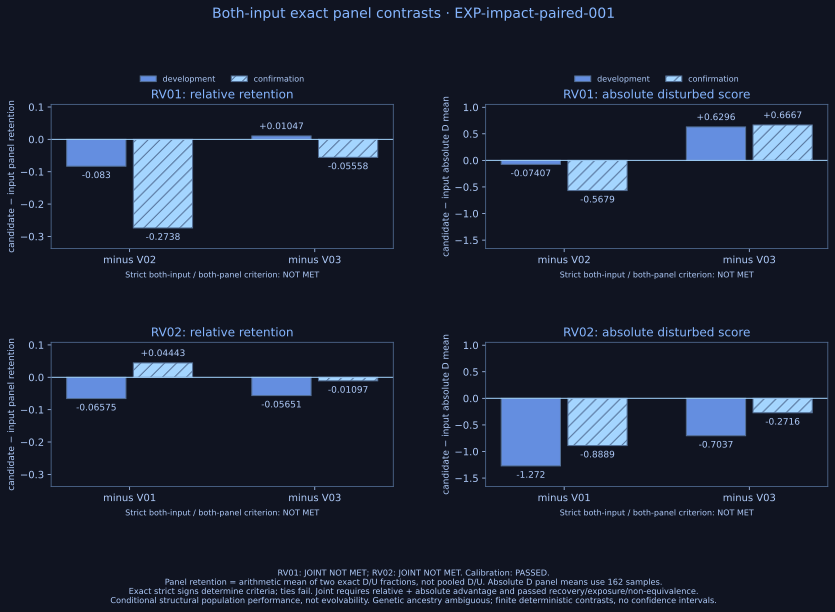
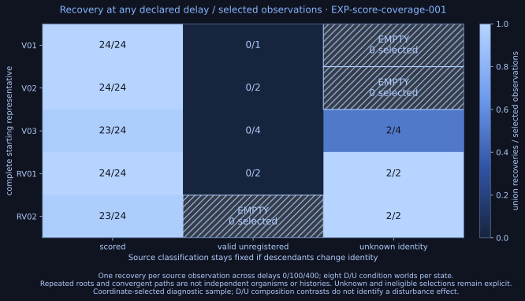
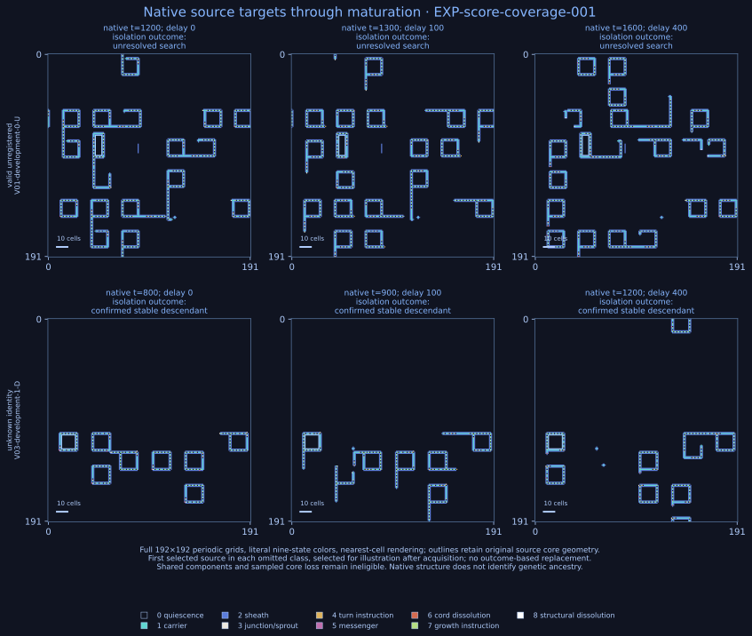
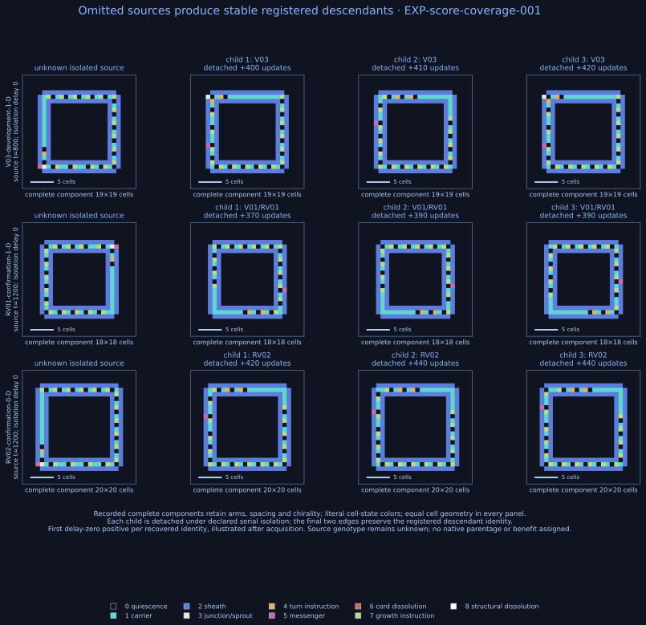
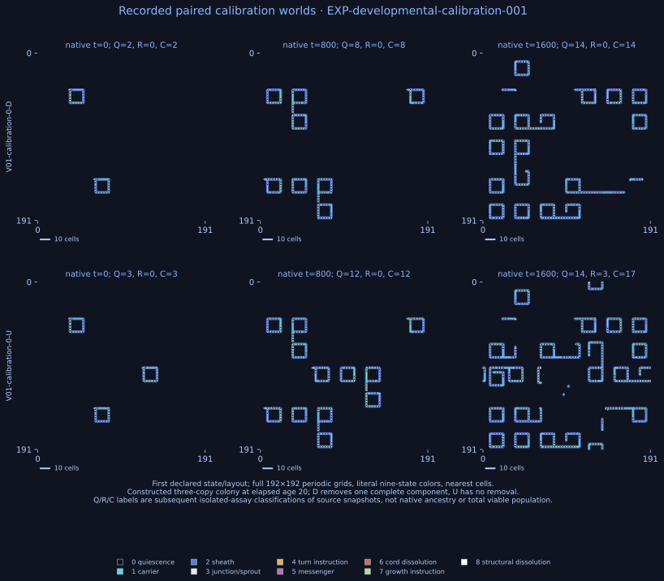

# Where Does Evolvability Reside? Organisms, Encounters, and Ecological History in Self-Reproducing Cellular Automata

**Separating candidate production, stable transmission, and ecological performance in controlled encounters**

## Abstract

Encounters can generate new forms; useful heritable variation requires transmission and ecological value. We investigate these stages in evoloops, a deterministic cellular automaton whose interacting reproductive structures can alter descendants. An initial two-organism atlas produced candidates in six of 40 contacting configurations but no confirmed stable novelty, including after delayed extraction and broader descendant search. A prospective three-identity atlas produced candidate words in 14/36 main and 4/18 held-out encounters, with none in 90 controls. Serial isolation confirmed pair-relative inherited novelty in two main configurations and none held out. One yielded a word absent from all three inputs; the other recovered a known third identity absent from its input pair. Candidate rank reversals and inherited interaction contrasts did not transfer held out. An ecological population-score comparison favored the known-word recovery under its frozen criterion, but most disturbances missed occupied cells and reserved confirmation duplicated development by rotation. A subsequent assay constructed standardized three-copy microcolonies, removed exactly one third of occupied cells and registered cores, and paired each disturbed state with its undisturbed continuation. Recovery calibration passed at 77/80 selected scored components and 30/30 preparation controls. All 40 paired worlds completed. Neither inherited state exceeded both inputs in both panels for relative population retention or absolute disturbed population; no originating encounter met the joint criterion. Some per-condition contrasts reversed, but age and geometry covaried. A prospective coverage assay recovered stable registered descendants from 6/8 selected unknown-identity sources and 0/9 valid-unregistered sources. The latter included productive capped searches, while the assay failed RV02's scored recovery threshold despite all 30 phase controls passing. The score therefore excludes recoverable source states. A new prospective source measure confirms 736/820 detected observations in 20 new calibration worlds, including ten unknown-identity sources sharing one complete input; all new qualification gates pass, while 84 observations remain unresolved. This finite isolation measure preserves the earlier failed gate and does not establish total viable population. A fully crossed age/layout design is frozen before its responses. These finite comparisons separate candidate production, stable transmission, and conditional performance. H1 and H3 remain untested; these results concern conditional encounters and performance, rather than a demonstrated increase in the capacity for adaptive change.

## 1. Introduction

A system's capacity for evolutionary change depends on more than producing new forms. For adaptive evolution, differences must pass to descendants and improve performance in a relevant environment. Separating these steps is particularly important when reproduction itself depends on interactions: an encounter may create a novel structure, help it reproduce, or destroy it before its differences can persist.

Evoloops make these possibilities observable. They are self-reproducing structures embedded in a two-dimensional cellular automaton. A circulating signal sequence participates in constructing offspring, while contact between reproductive structures can change the sequence and shape of the resulting loops. All events follow fixed local rules (Sayama, 1999). The model therefore lets us intervene on encounters without inserting a separate mutation operator.

Where, then, does the capacity to generate heritable variation reside? An organism may carry a transferable bias in the variants it produces. That bias may be expressed differently against different partners. Previous ecological conditions may shape both the organisms present and the encounters they experience. These are compatible contributions, whose identification requires different comparisons. We organize them as three hypotheses: **H1**, a contribution transferable with the organism under common encounter conditions; **H2**, a contribution specific to organism–partner combinations; and **H3**, historical effects mediated by changes in organisms and encounter distributions.

The present experiments address the encounter comparison. We first cross two input organisms across a defined spatial panel, then follow candidate variants through isolation and repeated reproduction. Crossing partners asks whether the outcome associated with changing one organism depends on the other. Following descendants asks whether any such pattern concerns temporary structural changes or transmitted variation. A calibration examines whether early extraction or restricted descendant search explains failed transmission. A fresh crossed atlas then uses three naturally generated, separately verified inherited identities, new configurations, and the calibrated descendant search to examine how far the original result depends on its input panel.

The completed studies recover both negative and positive transmission outcomes. The original candidates did not yield confirmed stable novelty under either calibrated search, whereas two configurations in the fresh atlas did. One produces a word absent from the input catalogue; the other recovers a known catalogue word absent from its input pair. Neither result transfers as an inherited-yield difference to the held-out configurations. Two subsequent paired ecological comparisons test both inherited outcomes against both originating inputs. One state meets the first finite proxy criterion, but ineffective disturbances and rotationally duplicated confirmation conditions limit its interpretation. A standardized microcolony comparison then imposes matched population loss and includes undisturbed controls; neither state meets its joint relative-and-absolute criterion. Together these studies establish what organism and history comparisons must measure: variation production, transmission, and ecological value as separate stages, with novelty defined relative to a declared comparison set.

## 2. Prior work and the experimental question

Sayama's original evoloop establishes interaction-mediated genotype change and spatial selection in deterministic, synchronous nine-state dynamics (Sayama, 1999). Later work shows that loops of the same size can differ in gene arrangement, colony morphology, persistence, and mutational bias. Salzberg and Sayama report round-robin competition among 15 size-4 genotypes and descendants inheriting variation biases (Salzberg and Sayama, 2004). These findings already connect inherited organization with evolutionary outcomes.

Salzberg, Antony, and Sayama examine genealogy, biased accessibility of larger species, pathogens, and localized or distributed disturbances (Salzberg, Antony, and Sayama, 2004). They also retain transient species that produce stable replicators in a later cycle. A failure to copy the first observed candidate immediately is therefore insufficient grounds for discarding its evolutionary potential. The recent review places these mechanisms within the broader problem of reproduction supporting inherited variation and discusses persistent questions of individuality and long-term evolution (Sayama and Nehaniv, 2025; preprint 2024).

Our experiment builds on these results by comparing the fate of variation under specified encounters. Population competition measures which types persist; here the immediate outcome is whether a particular encounter produces a new identity with a recoverable transmission path. Retaining nonproductive encounters supplies the denominator, while isolation tests and delayed extraction distinguish candidate appearance from later reproduction. The contribution is this intervention-and-measurement comparison, rather than the discovery of interaction-generated mutation or inherited mutational bias.

## 3. Methods

### 3.1 Dynamics and organisms

We use the original nine-state evoloop transition system, synchronous updates, and periodic boundaries. The neighborhood is center, top, right, bottom, left; rotations of explicit rules and the dissolution/default rules produce all 59,049 local transitions. The lookup table agrees exhaustively with the pinned CellPyLib reference and an independent expansion of the author's EvoLoopS rules (Antunes, CellPyLib; Sayama, EvoLoopS). Seed reproduction, deterministic replay, and checkpoint/resume are verified. Exact versions, hashes, licensing, and execution details are documented in [source review](../docs/source_review.md) and [reproduction instructions](../docs/reproducing-results.md).

S13 is CellPyLib's documented species13 seed, matching the author's `13.img`, rather than the alternative default `13-2.img` (Antunes, CellPyLib documentation). N01 is a stable descendant obtained from a 160×160 exploratory torus initiated with S13 at (65,45). Discovery samples every ten updates, considers up to four detached phases per candidate, and ends after two verified identities. This selected exploratory history supplies an experimental input; it is not replication across independently evolved populations.

A prospective discovery schedule (protocol 005) supplies the fresh extension with three naturally generated channel identities. It reverifies the original native N01 component, then searches three declared histories: the original 160-square S13 ecology to 12,000 updates, an S13/N01 encounter in 320-square space to 16,000, and an N01/N01 encounter in 320-square space to 16,000 or the three-identity stopping point. Sampling is every 20 updates, with at most two complete-component hashes per source composite identity and 32 verification trials per history. The first detached offspring must transmit its composite identity in two further isolated generations, and its word must equal the native source word. Selection also requires one unchanged core at elapsed offsets 20, 50, 80. Third detached descendants supply uniform input snapshots. Discovery selects on provenance and reproduction before viewing encounter outcomes; it is not independent-population replication.

### 3.2 Crossed encounters and controls

Before acquisition, protocol 001 specifies 32 main encounters, eight held-out encounters, and controls. Complete input snapshots advance alone by 0, 30, or 60 updates. Each resulting state must retain one recognized core, unchanged identity, and no boundary contact. These offsets refer to different snapshot origins; they are not necessarily homologous reproductive phases.

All four ordered S13/N01 pairings are tested against four main geometries at offsets 0 and 60, giving eight configurations per pair. Two held-out geometries at offset 30 give two further configurations per pair. Near configurations occupy 384×384 tori, with specified positions, rotations in 90-degree increments, and nonoverlapping input rectangles. Forty separated controls retain identities, offsets, orientations, and row displacement in 640×640 tori, with horizontal displacement of 320 cells. Twenty-four solitary controls cover organism, offset, and orientation. Every configuration runs for 1,600 completed updates; separated controls are checked for contact throughout.

The fresh protocol 006 defines nine ordered V01/V02/V03 pairings, four main configurations per pair at offsets 20/80, and two held-out configurations per pair at offset 50. Complete phase snapshots, relative displacements, and rotations differ from the original panel. All 144 near, separated, and solitary arenas use the same 640-square periodic domain. The 54 paired separated controls change only horizontal partner displacement; 36 solitary states cover each organism, offset, and orientation. The panel and its complete starting states were frozen before acquisition. Main and held-out configurations use different phases, orientations, and offsets; each is a specified finite panel rather than a random sample of encounters.

### 3.3 What counts as a variant?

A structural detector samples rectangular zero-valued cores with intact inner sheaths in states 2/3 every ten updates. For channels containing only states 0/1/4/7, we read a clockwise signal word, preserving carrier spacing and normalizing by cyclic shift without reflection. Pairing this word with sorted core dimensions defines the operational composite identity. It preserves chirality but differs from the published counterclockwise, birth-anchored species identifier (Salzberg, Antony, and Sayama, 2004). Contaminated channels have unknown identity; recognized cores alone do not establish viability.

In the original atlas, a candidate composite identity must differ from both encounter inputs. A reporting audit introduced during acquisition, before inheritance analysis, additionally distinguishes signal-word novelty from shape-only differences. That composite endpoint remains the frozen primary definition; word-only novelty is a separately labeled, post-hoc sensitivity endpoint (protocol 002). The fresh atlas prospectively screens for a native signal word different from both inputs and records morphology-only changes separately. A candidate may match the third catalogue identity: novelty here is relative to the input pair, not global sequence novelty. This narrower screen leaves morphology-only routes to later word changes outside the inheritance endpoint.

Occupied input cells receive provenance masks 1 and 2; newly occupied cells inherit the union of occupied contributors in their neighborhood. Contact is the first update containing exclusive-provenance adjacency or mixed occupied provenance. These masks overapproximate causal contribution and do not identify genetic parents. After contact, novelty is consequently a pair-level outcome.

Core coordinates track structures. Appearances and losses are interval-censored within ten updates; reported candidate times are first sampled observations, not exact mutation or birth times. A changed word at an existing core can be registered without a new-core appearance event. The legacy detector does not join structures across the torus seam, so boundary contact limits the earlier native counts. The fresh atlas uses independently validated periodic recognition: four cuts cover cores whose six-cell padded bounding dimensions are smaller than half each domain dimension, occupied components are joined across seams, and a single-core component is unwrapped only when an empty row and column allow its complete extent to be retained. Winding and multicore components remain ineligible. Nonrectangular structures can escape either detector. Structure persistence, lineage survival, candidate novelty, inheritance, and benefit remain distinct measurements.

### 3.4 Testing transmission after isolation

The initial assay extracts the entire occupied connected component, including reproductive arms, if it contains exactly one recognized core and avoids the boundary. It places the component in an empty 192×192 torus. Shared, boundary-spanning, and oversized components are ineligible. The earliest two distinct extractable snapshots per run/identity define the search budget; size checks occur after capture, so oversized attempts consume that budget and remain unresolved.

Each generation runs for up to 1,600 updates. In the first legacy stage, the first newly positioned, valid closed core with a detached component supplies the next isolated generation. Later legacy stages select the first detached core matching the proposed stable composite identity, skipping other identities; the expanded search instead retains alternate valid descendants. A candidate may first produce a different stable descendant. That descendant must transmit the same identity twice consecutively, requiring an additional generation when the original candidate was transient. Closure and detachment are recorded separately. Stable identities first arising after extraction are labeled assay-derived and checked again against both inputs.

A path without qualifying reproduction by the horizon is unresolved; an empty grid is extinction under isolation. Either outcome can coexist with an unexamined successful path or ecological dependence. Complete-component extraction preserves active arms, avoiding the disruption caused by cropping only the central body.

### 3.5 Delayed extraction and expanded descendant search

Protocol 004 tests whether maturation or a broader search recovers inheritance missed by the initial assay. It follows all seven candidate identities, nested within six originating configurations. At first observation, the lexicographically first matching core tuple fixes the target. No later successful structure may replace a lost target. Verified S13 and N01 snapshots in empty 384×384 worlds provide positive controls.

Extraction occurs after 0, 60, 120, or 240 updates: 28 candidate-delay and eight control observations. Ten-update tracking distinguishes target loss and subsequent same-tuple recurrence. Lost, recurrent, unknown, shared, boundary, and oversized targets are ineligible. Each delayed world also continues natively for 1,600 updates. Matching words elsewhere are structural observations; they do not establish offspring ancestry. These continuation windows overlap and are not independent observations.

Every eligible component enters both the unchanged legacy assay and an expanded search. The expanded search collects the first three detached, newly positioned valid cores per generation, once per core tuple, ordered by time, coordinates, and snapshot hash. This is the operational offspring criterion; a core appearance event alone is not sufficient. Depth-first traversal permits at most six simulated generations along a path and 24 generation simulations per root, each lasting at most 1,600 updates. Identity changes reset the transmission streak. Two identical consecutive transmissions confirm stability. Candidate recovery requires a stable signal word different from both inputs; control recovery requires the original composite identity.

Comparing searches on the same snapshot isolates search sensitivity. Comparing delays combines maturation with continued ecological interaction. Ineligible extractions and unexamined branches remain explicit.

The fresh atlas applies the same expanded search budgets with periodic recognition to the earliest two distinct complete-component snapshots per run/composite candidate identity. Stable transmission requires two consecutive identical composite identities and a stable word different from both inputs. Transients may produce another stable identity. Size-ineligible snapshots consume an attempt; missing components and capped paths remain unresolved. Native appearance, isolated transmission, and ecological dependence are separate outcomes.

### 3.6 Analysis and ecological benefit

The original primary endpoint is any confirmed novel stable composite identity per near configuration; the fresh primary endpoint is any confirmed stable word different from both inputs, conditional on its prospective native-word screen. Each retains all declared near states in its denominator: 40 in the original atlas and 54 in the fresh atlas. Rates are reported separately because the panels and candidate screens differ. Catalogue-relative novelty is a supplementary description, not a replacement for the pair-relative endpoint. Candidate and unresolved outcomes are reported separately. For each main or held-out panel, an interaction contrast is a difference of differences; the original two-input comparison is:

`[rate(S13,S13) − rate(N01,S13)] − [rate(S13,N01) − rate(N01,N01)]`.

This measures pair-configuration interaction under ambiguous parentage, rather than an identified focal mutation capacity. The configurations form a specified finite panel, not a random sample from a natural encounter distribution. Deterministic reruns verify reproducibility. Accordingly, we report descriptive contrasts without binomial intervals or inferential p-values. Held-out geometries assess configuration transfer; they do not supply independent organisms or evolutionary histories. For the three-input atlas we report focal and partner marginal means, residuals from their additive decomposition, and all nine contrasts obtained by choosing two focal identities and two partner identities. A strict rank reversal requires opposing, nonzero focal contrasts across partners; persistence requires the same two signs in the held-out panel. These analyses concern pair-level outcomes because provenance does not resolve genetic parentage.

The ecological schedules and benefit criterion were frozen with protocol 006 before the confirmed outcomes were known. Protocol 007 prospectively specifies state preparation, the fixed score registry, score calibration, and arithmetic for the paired comparison. Both acquisition and analysis are complete; the following describes the implemented score and paired criterion. A separate audit examines whether reserved conditions supply a new ecological challenge.

### 3.7 Ecological score and recovery calibration

We retain both inherited outcomes. RV01 is the recovered V01 composite identity from the V02/V03 encounter; RV02 is the 14×14 identity absent from the three-input catalogue, from V01/V03. Their representatives are chosen by earliest native capture followed by run/root order, using the complete final detached descendant. V01/V02/V03 retain their third detached discovery snapshots. No arms are stripped and no preparation phase is advanced. RV01 and V01 have the same composite identity but different complete snapshots, so these are comparisons of declared states rather than words alone.

Each whole snapshot is rotated, then placed in an empty 192×192 torus with its top-left row and column at `96 − floor(height/2)` and `96 − floor(width/2)`. All five states and their hashes are retained. Their four unique exact composite identities define one fixed score registry, deduplicating V01/RV01. The score counts every recognized core with an identity in that registry, regardless of its starting organism. Unregistered valid and unknown-identity cores are recorded separately; the registry is never expanded in response to performance. This is a known-identity structural population measure, potentially omitting viable unregistered descendants.

The prospective recovery calibration comprises five baseline snapshot controls and ten new ecologies: each prepared state under rotation 0/block (80,80) and rotation 1/block (80,112). These conditions differ from the development and reserved confirmation conditions. At native updates 400, 620, 1,020, and 1,400, recognized cores are divided into registry-scored and unscored classes; the latter includes unregistered valid and unknown identities. The first and last distinct lexicographic core tuples are selected within each class, once if only one exists, with an explicit empty stratum if none exists. Selection precedes inspection of descendant fate. At most 80 scored and 80 unscored observations are selected; they are nested deterministic observations, not independent organisms or histories.

Eligible complete single-core components retain arms and use validated periodic unwrapping. Shared, winding, oversized, and otherwise ineligible components remain in the selected-observation denominator. The bounded isolation search retains up to three detached valid offspring per generation, six generation states in depth, and 24 generation simulations per root, each with a 1,600-update horizon. Scored observations must recover two consecutive transmissions of the originally counted exact composite identity, allowing transient intermediates. Unscored observations can recover any stable composite identity and provide a descriptive measure of excluded recoverable structures. Baselines require recovery of their original identity.

The calibration gate requires all five baselines, at least 90% original-identity recovery among all selected scored observations, at least 80% in each starting-state group with observations, and at least one recovery in every nonempty state-by-condition-by-source-time scored stratum. A starting-state group without selected scored observations, or a zero overall denominator, fails the implemented gate. These fixed finite-panel thresholds are practical validation criteria; ineligibility and nonconfirmation do not prove native nonviability.

Each selected native source also receives a 1,600-update structural continuation, reusing its ecology extended to update 3,000. Remaining absolute disturbances at 600/1,000 are retained, with none thereafter. Fixed-core loss/recurrence, endpoint identity, and matching words elsewhere are recorded at 20-update resolution. The windows overlap and do not assign offspring ancestry. Even a passing gate supports sampled recoverability under imposed isolation and a calibrated known-identity proxy, not an exact census of viable organisms in the crowded native world.

### 3.8 Frozen paired ecological comparison

All five prepared states undergo all four frozen conditions: development rotations 0/1 with block top-left coordinates (40,40)/(128,128), and reserved confirmation rotations 2/3 with coordinates (40,128)/(128,40). Each condition runs for 1,600 updates, clearing a 24×24 block at 600 and 1,000. The unchanged synchronous CA advances to the disturbance time, the block is set to state zero, then detection and sampling occur. The 81 samples at 0,20,…,1,600 include the starting state and all zero counts with equal weight. Actual removed occupied cells and pre/post core counts are retained, including zero-impact removals; these cannot by themselves establish recolonization after population loss.

Five states across four conditions yield 20 prepared state-condition simulations. Common input scores are reused across pairs. RV01 is compared conservatively with V02 and V03; RV02 with V01 and V03. Within each condition, candidate and both inputs receive the same schedule. Each panel averages its two condition scores. The strict criterion requires a candidate to exceed each originating input in both development and confirmation panels; exact ties fail. Comparison uses integer count sums over 162 samples per panel, avoiding rounding artifacts. Conditions are deterministic assessment configurations, not independent population replicates.

If calibration passes, the criterion records a finite advantage under the calibrated known-identity population proxy. Its intended ecological interpretation concerns persistence and recolonization; actual depletion and distinct confirmation challenges must be checked separately. If it fails, every one of the 20 frozen states still runs as a structural diagnostic, while benefit confirmation is blocked and beneficial-heritable yield remains unknown. Revised scores or gates require a separate prospective protocol. Encounter denominators remain 36 main, 18 held-out, and 54 overall, with other candidate fates unresolved. Neither a structural score increase nor confirmed assay advantage alone establishes increased evolvability, H1/H3, or recursive self-improvement.

### 3.9 A standardized microcolony intervention matches actual population loss

Protocol 009 defines a subsequent comparison intended to separate multiplication in an undisturbed world from response to measured depletion. Its exposure-only preparation pilot examines native three-core states without following a disturbed future. Such states are often joined or otherwise ineligible for complete-component removal. The response experiment therefore uses explicitly constructed three-copy microcolonies, rather than sampled native populations or historical transplants. All five prepared organism states and the unchanged four-identity registry are retained. The earlier frozen outcomes and their interpretation remain separate.

Each complete detached representative advances alone on the original 192-square periodic CA for declared ages 0, 20, 30, 100, 110, and 120 updates. These are elapsed ages from the verified snapshot, not homologous intrinsic reproductive phases. Preparation requires exactly one original-identity core in a contractible occupied component containing every occupied cell. Arms and embryos are retained. Proposed ages 40/80 were rejected before response acquisition because V03 retained an extra disconnected cell; a ten-update preparation-only eligibility scan supplies the revised ages. The rejected preparation is preserved, and no cell is discarded to make it eligible.

Three identical complete components are placed by core coordinates at each configuration's fixed nonsymmetric site triangle, all at orientation zero. Copies must be nonoverlapping, distinct single-core components, with every occupied cell accounted for. The disturbed initial state removes the designated complete component, including its arms, at update zero. The undisturbed control retains the identical prepared three-copy grid. Validation requires three registered cores to become two, precisely one third of occupied cells to disappear, and the two remaining components to be byte-identical. This matches fractional structural impact; absolute cell numbers, reproductive value, and later ecological consequences can differ. No further intervention occurs during observation.

Development uses ages 0/100, reserved confirmation 30/120, and separate calibration 20/110, with declared sites and removal indices in [the frozen configuration](../configs/impact-v1.json). Before acquiring responses, complete disturbed and undisturbed states are compared under all 90-degree rotations and periodic translations across development and confirmation. Effective equivalence blocks distinct-condition confirmation. Mask transformations and cross-state equivalences are retained separately; mask geometry alone need not differ when the occupied worlds do. The prepared states, source snapshots, removal masks, and hashes are frozen before their post-removal futures are observed.

### 3.10 Calibrated paired retention and absolute population advantage

The new score calibration tests all 30 isolated age-specific complete components as baseline controls, and follows ten separate disturbed calibration worlds to update 2,800. At times 0, 400, 800, and 1,200, the lexicographically first and last distinct cores are selected within registry-scored and unscored classes, once if only one exists. Ineligible observations stay in their denominators. The previously declared expanded isolation search tests original-identity recovery for scored roots and any stable identity for unscored roots, with the same offspring, depth, simulation, and horizon limits. Structural native continuations extend 1,600 updates from each source time; their overlapping fixed-core and matching-word observations do not establish offspring ancestry.

The prospective gate requires recovery from all 30 baseline components, at least 90% of all selected scored observations, at least 80% within each starting-state group, and at least one recovery in every nonempty scored stratum. This validates selected recoverability under isolation, rather than an exact census of viable population. Unscored observations provide a separate coverage check. The registry remains frozen regardless of their fate.

The paired batch comprises 40 worlds: five states, four development/confirmation conditions, and disturbed/undisturbed versions of each starting grid. Each runs for 1,600 updates with 81 equally weighted registered-core samples at 0,20,…,1,600, including the immediate removal and all zeros. For each condition, integer sums D and U give retention D/U, undefined if U is zero. Panel retention is the arithmetic mean of its two exact condition ratios, rather than a ratio of pooled sums. The primary relative criterion requires the candidate's panel retention to exceed each originating input in both panels; exact ties fail. Absolute disturbed mean population is reported separately over 162 samples per panel.

Joint calibrated population advantage requires the relative criterion and a strictly larger absolute disturbed score than both inputs in both panels, together with passing calibration, exact-exposure validation, and development/confirmation non-equivalence. RV01 is compared with V02/V03 and RV02 with V01/V03. Requiring absolute advantage guards against interpreting better retention of a weak undisturbed baseline as superior disturbed performance. D−U and all per-condition contrasts are also retained. D greater than U is compatible with removal reducing interference, but does not itself identify that mechanism.

If score calibration fails, all paired conditions still run as structural diagnostics; numerical criteria are retained while joint ecological confirmation and its encounter yield remain unknown. A positive joint classification, if any, is linked only to its originating encounter and the declared 36 main, 18 held-out, and 54 overall denominators. Other candidate fates remain unresolved. Configurations, age controls, and sampled cores are nested deterministic comparisons; no independent-history uncertainty is assigned to them. Neither population retention nor joint advantage establishes increased evolvability, H1/H3, or recursive self-improvement. Acquisition and analysis of this subsequent comparison are complete; its results retain the distinct criterion and preparation scope.

### 3.11 Prospective coverage of paired-world scores

Protocol 010 tests whether structures excluded by the fixed registry can produce stable descendants after isolation. It freezes all 40 paired response starts, 30 complete phase controls, the registry, and earlier outcomes before selecting roots. At source updates 400, 800, and 1200, each world supplies its lexicographically first core in each class: registry-scored, valid unregistered identity, and unknown identity. Selection precedes eligibility filtering; empty strata and class availability are retained. Source class remains fixed if the structure later changes. The source observation is the counting unit, nested within deterministic worlds; repeated delays and identical inputs provide no independent-population replication.

Native continuation extends 1600 updates from each source, sampled every 20 updates, with complete grids at all isolation times. Delays are 0, 100, and 400 updates. Each delay follows the exact source core; any sampled disappearance before isolation makes that delay ineligible, even if the same coordinates recur. Matching-word appearance elsewhere is structural evidence, without assigned genetic ancestry. Conservative periodic extraction retains the entire single-core component and arms, rejects shared or noncontractible components, and uses validated empty-row/column unwrapping.

Isolation retains the existing 192-square domain, 1600-update generation horizon, ten-update detection cadence, three-offspring cap, depth six, and 24-simulation root limit. Each search starts with the measured delayed identity, or unknown if none can be read. Any stable identity is accepted for selected source classes; phase controls must recover their original identity. Confirmation requires two consecutive unchanged identity edges after the first known identity. Capped, unsearched, ineligible, ancestry-ambiguous, and unknown-source cases remain distinct; no benefit assay is performed.

The primary omission endpoint counts a selected omitted source once if any delay confirms stable transmission. The recovery gate instead uses scored roots at delay zero: all 30 phase controls must recover their original identity, scored recovery must reach 90% overall and 80% within each state. Later maturation cannot rescue a failed source-time gate. Failed calibration leaves omission existence findings as diagnostics rather than a calibrated census or treatment-effect estimate. Earlier scores and benefit classifications stay frozen. A separately labeled post-acquisition comparison groups identical complete component inputs without altering the primary endpoint.

### 3.12 Recoverable developmental source states and a crossed design

The coverage result motivates a new prospective measure rather than a larger identity registry. Protocol 011 defines C as every detected core at five source snapshots, Q as source bodies whose complete single-core components produce a stable descendant identity through two consecutive unchanged isolated transmissions, and R=C−Q as unresolved sources. Unknown source identity is eligible; its later descendant identity never replaces the observed unknown genotype. Shared, noncontractible, oversized, nonproductive, isolated-extinct, capped, and unsearched sources remain in R. Each source contributes at most one to Q. The range [Q,C] describes potentially recoverable detected bodies under the isolation assay; it does not bound all viable organisms or establish native reproduction. Detector omissions remain outside C.

Five prepared states, two new age/layout conditions at elapsed ages 20 and 110, and disturbed/undisturbed twins give 20 calibration worlds. Complete three-copy components retain their arms; removing one verifies exact one-third occupied-cell and nonzero cell-state loss and registered cores 3→2. All complete starts are distinct under rotation/translation from every prior microcolony world. Native evolution runs 1, 600 updates; source censuses occur at 0, 400, 800, 1200, 1600, and the original registry score remains separately sampled at 81 times. Census snapshots are nested observations rather than independent populations.

Delay-zero searches retain the prior horizon, domain, three-child, depth-six and 24-simulation limits. Each world admits its first 128 distinct eligible complete-input keys in time/core order, including cached keys; later keys remain unresolved in the full denominator. Reuse requires identical complete patch, rule, configuration, source identity, and acceptance endpoint. Controls repeat all 30 original-identity phase inputs and three previously recovered unknown-source inputs, with any stable identity accepted for the latter. These known outcomes check assay implementation, not new replication. Qualification requires all controls, scored-source recovery of 90% overall and 80% per state, and separately Q/C≥4/5 for each state×treatment aggregate. Resolved share measures the width of this source envelope, not sensitivity to all viable organisms. Failed gates remain failed; calibration assays no benefit.

Protocol 012 subsequently freezes four elapsed ages (0, 30, 100, 120) at each of four nonsymmetric layouts, for all five states and paired treatments: 160 complete worlds and 80 pairs. A/B are development layouts and E/F reserved layouts. Every reserved complete start must differ under rotation/translation from every development, prior microcolony, and new calibration start, including cross-state comparisons. Earlier observed development aliases remain labeled deterministic repeats. Fixed-layout age contrasts hold placement constant; fixed-age layout contrasts hold source preparation constant. Layout contrasts include the declared removed-clone position, so they compare complete spatial challenges and cannot isolate a pure distance effect. Their difference of age differences describes interaction. Elapsed age is not a homologous reproductive phase; constructed clone colonies are not native-history transplants. Reserved E/F compare different layouts from A/B, not independent replication of identical geometry treatments.

For each condition, five-snapshot sums define retention bounds [Q_D/C_U,C_D/Q_U], using exact integers and rational arithmetic. Zero C_U is undefined and zero Q_U gives an unbounded upper endpoint. Panel bounds average eight condition ratios; totals are never pooled. Robust relative superiority requires the candidate lower bound to exceed both originating input upper bounds in both panels; absolute superiority separately requires candidate disturbed Q to exceed both input disturbed C means. Ties fail. Overlapping or unbounded comparisons leave robust advantage unresolved, rather than proving zero benefit. Joint confirmation additionally requires calibration, exact exposure and non-equivalence. A failed calibration permits diagnostic crossed comparisons but prevents joint confirmation. The design is frozen after calibration assessment; its response acquisition requires a separately validated runner and benchmark.

## 4. Results

### 4.1 A transient structure supplies an inherited input variant

In discovery, a candidate first observed at update 2,910 had an 11×13 core and a signal word different from S13. Isolation yielded a 12×12-core descendant, followed by two generations transmitting that stable identity. Detachment was first observed after 380, 390, and 390 updates in the successive assays, at ten-update resolution. N01 denotes the stable descendant. The transient and stable forms share the changed word, distinguishing morphological stabilization from signal change. This observed route motivates allowing transient-to-stable paths in encounter assays.

The prospective discovery reached three eligible identities in 79 selected native-component trials: the original N01 source and 78 new trials. V01 is the reverified N01 word; the native sources of V02 and V03 were first observed in the N01/N01 history at updates 3,440 and 5,040, sampled every 20 updates. Each retains its native word while stabilizing from a 12×14 to a 13×13 core under isolation. Their stable words differ from one another and from V01. Seventy-four trials were unresolved or changed identity before completing the declared transmission chain; two recovered stable words different from their native source and were therefore rejected. These counts describe input selection, not encounter yields.

| Input | Native history, time | Native → stable core | Detachment times |
|---|---|---|---|
| V01 | Original discovery,2910 | 11×13 →12×12 | 380,390,390 |
| V02 | N01/N01,3440 | 12×14 →13×13 | 430,410,420 |
| V03 | N01/N01,5040 | 12×14 →13×13 | 410,420,410 |

Times are updates from each isolated generation's start, sampled every 10. Both new identities come from the same history and are separately verified, not independently evolved population replicates. These positive transmission paths broaden the input panel and show that the earlier negative encounter result does not amount to a general inability of transients to stabilize.

### 4.2 Encounters produce candidate changes without confirmed stable transmission

All 40 near configurations contacted within the observation window. Five of 32 main configurations and one of eight held-out configurations produced candidate composite changes. All seven candidate identities also differed in signal word from both inputs, so the post-hoc word-only classification agrees here. Separated controls produced 0/40 candidates and solitary controls 0/24. No atlas state received a boundary-touch flag. The matched near-minus-separated candidate contrast is 6/40, or 0.150, for this panel.

Five candidate-producing configurations supplied 11 isolation snapshots; the remaining candidate could not be separated. None confirmed stable novel transmission. Six paths produced changed detached descendants in their first stage: four subsequently dissolved, and two failed to reproduce the same identity by the next horizon. Two initial snapshots dissolved, and three produced no qualifying detached descendant. These observations separate candidate appearance from transmission under the stated assay.

| Pair | Candidates: main | Candidates: held-out | Inherited: main; held-out |
|---|---:|---:|---:|
| S13 × S13 | 3/8 | 0/2 | 0/8; 0/2 |
| S13 × N01 | 0/8 | 0/2 | 0/8; 0/2 |
| N01 × S13 | 1/8 | 1/2 | 0/8; 0/2 |
| N01 × N01 | 1/8 | 0/2 | 0/8; 0/2 |

Changing the focal organism in the main panel gives candidate contrasts of +0.250 with S13 as partner and −0.125 with N01 as partner: a rank reversal and interaction contrast of +0.375. Held-out contrasts are −0.500 and 0.000, giving −0.500 without a strict rank reversal. The candidate pattern does not transfer to the held-out configurations. All confirmed-inheritance contrasts are zero because no tested path satisfies the criterion; the candidate pattern therefore does not establish an interaction in useful heritable variation.

Thirty near states lost both initial recognized cores, although many retained input-type descendants. Five ended without a recognized core: one empty and four retaining debris. Initial cores also disappeared in all separated and solitary controls while colonies continued. Individual-core loss is therefore an unsuitable substitute for lineage extinction.

### 4.3 Neither delayed extraction nor broader search recovers candidate inheritance

An exploratory extension first followed the earliest N01×N01 offset candidate, observed at encounter update 1,550. Its 3×12-core source produced a 6×6 descendant, then a 4×4 descendant that dissolved at the third isolation stage. This selected diagnostic motivates examining more paths, but adds no independent confirmation.

The subsequent prospective calibration completed all 36 observations. Of 28 candidate-delay observations, 15 were eligible, ten had lost the fixed source core, and three remained shared. No extraction was excluded for recurrence, unknown identity, boundary contact, or size. All eight controls were eligible. Both searches confirmed 0/15 novel candidate paths and recovered 8/8 known control identities. None of the six originating configurations supplied a confirmed novel path. The 13 ineligible observations remain in the denominator for extraction eligibility; their inheritance outcomes are missing.

| Delay | Eligible / observed | Novel: legacy; expanded | Parents: legacy; expanded |
|---|---:|---:|---:|
| 0 | 4/7 | 0/4; 0/4 | 2/2; 2/2 |
| 60 | 4/7 | 0/4; 0/4 | 2/2; 2/2 |
| 120 | 4/7 | 0/4; 0/4 | 2/2; 2/2 |
| 240 | 3/7 | 0/3; 0/3 | 2/2; 2/2 |

Expanded search examined 69 candidate and 16 control generation states. No root reached the 24-simulation or six-transmission limit. Eighteen candidate generation states reached the three-offspring collection limit, leaving later offspring unexamined. Each delay of the 3×12 source generated ten searched states without stable recovery. Other eligible roots produced descendants that dissolved under further isolation or remained unresolved at the horizon.

In native continuation, the 9×9 candidate word appeared at another core at original encounter times 1,150 and 1,160. Its appearance in all four overlapping windows is one structural recurrence, not four independent reproduction events. No candidate original word was recognized at the endpoint of its continuation windows. However, boundary flags occurred in 16/28 candidate and 2/8 control windows, limiting these counts. Control words appeared at new locations and persisted at all eight endpoints. Native endpoint absence consequently cannot establish candidate extinction.

### 4.4 A fresh panel recovers two pair-relative inherited outcomes

EXP-atlas-002 completed all 144 frozen states. Contact occurred in all 36 main and 18 held-out near configurations, at updates 151–990 and 251–1,090 respectively. None of the 54 separated controls contacted. Native candidate words occurred in 14/36 main and 4/18 held-out states, compared with 0/54 separated and 0/36 solitary states. No morphology-only changed identities were observed in near states. The paired near-minus-separated candidate contrast is 18/54, or 0.333.

| Pair | Candidates: main | Candidates: held-out | Inherited: main | Inherited: held-out |
|---|---:|---:|---:|---:|
| V01 × V01 | 1/4 | 0/2 | 0/4 | 0/2 |
| V01 × V02 | 2/4 | 0/2 | 0/4 | 0/2 |
| V01 × V03 | 2/4 | 0/2 | 1/4 | 0/2 |
| V02 × V01 | 2/4 | 1/2 | 0/4 | 0/2 |
| V02 × V02 | 0/4 | 0/2 | 0/4 | 0/2 |
| V02 × V03 | 2/4 | 1/2 | 1/4 | 0/2 |
| V03 × V01 | 1/4 | 1/2 | 0/4 | 0/2 |
| V03 × V02 | 2/4 | 0/2 | 0/4 | 0/2 |
| V03 × V03 | 2/4 | 1/2 | 0/4 | 0/2 |

Bounded serial isolation confirms pair-relative inherited novelty in **2/36 main configurations and 0/18 held-out configurations**. Combined yield is 2/54, or 0.037, conditional on this panel, horizon, screen, and search. Fourteen main and four held-out candidate-producing states supply 52 run/composite identities and 88 extraction roots. Eight roots confirm the endpoint, but they converge on two stable identities from two configurations; they are not eight independent inherited events. Six candidate identities lack an extractable phase. The other 16 candidate-producing configurations remain unresolved for stable novel inheritance under the bounded search.

Both successful configurations use the parallel geometry at elapsed offset 20. In `near-main-V01-V03-p20-a-parallel`, contact begins at update 224. A 13×15-core candidate observed at 1,110 produces a 14×14-core isolated descendant, followed by two transmissions first observed after 440 updates each. Its stable word equals the native candidate word and differs from all three catalogue words. A matching 14×14 composite identity appears natively at 1,550 and also reproduces twice after extraction. Roots captured ten updates apart converge on identical later snapshots. This is one configuration with a stable word absent from the catalogue, giving supplementary catalogue-relative yield 1/36 main and 0/18 held out.

In `near-main-V02-V03-p20-a-parallel`, contact begins at update 233. A 12×13 candidate at 460 produces a different word in a 12×12 isolated descendant, which transmits twice, first observed after 390 updates in each generation. The stable identity exactly matches **V01**. That word is absent from V02 and V03 and therefore satisfies the frozen pair-relative endpoint; it is a recovery of an existing catalogue identity. V01's word also appears natively at 860 in a 12×12 core and reproduces after extraction. Its native appearance does not assign ancestry to the earlier candidate. The changed-word transition along the 460 extraction path occurs in the imposed isolation assay; the stable-word native observations and their own isolation tests provide separate evidence.

*Each row shows one complete captured component and its recorded isolated descendants from a successful configuration. Multiple extraction roots within each encounter converge on the same stable identity; they are not independent encounter outcomes. Sources and regeneration commands are in the figure manifest.*

The expanded search executes 1,205 generation simulations. It records 134 simulation-budget and 24 depth-limit truncations; 441 nodes reach the three-offspring collection cap. Later branches, unsampled phases, and ecological dependence remain unexamined. Edge activity occurs in 73/144 native arenas; the fresh periodic detector handles validated small rectangular bodies and contractible single-core components, while large, nonrectangular, winding, and shared structures remain outside the confirmed extraction scope.

Main-panel candidate contrasts show two strict focal rank reversals. For V01 minus V02, the contrasts are −0.250 against V01 and +0.500 against V02, producing a difference of differences of −0.750. For the same-size V02 minus V03 comparison, the contrasts are +0.250 and −0.500, producing +0.750. Neither strict reversal persists held out. Inherited main contrasts compare V01 or V02 against V03: changing from a V01 or V02 partner to V03 changes the focal contrast from zero to +0.250, giving a difference of differences of −0.250. All held-out inherited contrasts are zero, and neither split contains an inherited strict rank reversal. These are descriptive pair-configuration interactions; the concentration of successes in the V03 partner column alone would not establish H2. Both inherited outcomes enter the subsequent paired ecological comparison.

### 4.5 Sampled recovery passes the frozen ecological-score calibration

EXP-ecological-calibration-001 completed five baseline controls and ten calibration ecologies. All five baselines recovered their original composite identity. All 68 selected registry-scored components were eligible; 63 recovered their original identity through the required stable transmission chain, and five remained unresolved under the bounded search. The pooled recovery fraction is 63/68 (92.6%). Each starting-state group exceeds its 80% threshold, and all 40 nonempty scored strata contain at least one recovery. The frozen calibration gate therefore passes.

| Prepared state | Original-identity recovery / selected |
|---|---:|
| V01 | 14/15 |
| V02 | 11/12 |
| V03 | 12/13 |
| RV01 | 14/15 |
| RV02 | 12/13 |

The calibration executes 141 generation simulations; 136 nodes reach the three-offspring collection cap, with no depth or simulation-budget truncations. No unscored core is selected because all sampled unscored strata are empty. Recovery sensitivity for viable unregistered identities therefore remains untested; empty strata do not establish the completeness of the fixed registry.

Each of the five nonconfirming roots supplies no detached qualifying child within its isolated horizon. Three isolated grids become empty (V02, V03, and RV02), while V01 and RV01 remain nonempty without qualifying reproduction. These are three extinctions under the imposed isolation assay and two unresolved reproduction outcomes, not five demonstrated native deaths. In every corresponding native continuation, the fixed-coordinate core is lost and later recurs with the original identity, present again at the continuation endpoint. Recurrence at the same coordinates does not establish that the same individual survived or assign offspring ancestry.

*The original identity is recovered from 63/68 selected scored components and 5/5 baselines. Components are nested within ten deterministic ecologies; they are not independent population histories. Unscored-class recovery is untested because no such observation is selected. [Stratum-level results](../figures/eco1-calibration-strata-dark.svg) retain the finite denominators.*

### 4.6 One inherited state meets the finite proxy criterion, without independent ecological confirmation

EXP-benefit-001 completes all 20 frozen state-condition simulations. The score counts cores in the fixed four-identity registry. V02 has an unregistered valid core at two of 81 sample times in each condition; unknown-identity cores also occur briefly in other states. These structures are excluded from the score and their viability remains untested. Empty unscored strata at the calibration source times do not imply absence of unscored structures in the paired worlds. Each panel combines 162 equally weighted samples from two conditions. Development and reserved confirmation means are identical for every prepared state:

| Candidate | Originating inputs | Candidate mean | Input means | Frozen criterion |
|---|---|---:|---|---|
| RV01, recovered V01 | V02, V03 | 3.580 | 3.370, 3.321 | Met |
| RV02, new 14×14 | V01, V03 | 3.136 | 3.562, 3.321 | Not met |

RV01 exceeds V02 by 34/162 counted-core sample units (+0.210) and V03 by 42/162 (+0.259) in each panel. RV02 falls below V01 by 69/162 (−0.426) and V03 by 30/162 (−0.185). No tie or rounded comparison determines these outcomes. The formal proxy-criterion yield is **1/36 main configurations, 0/18 held out, and 1/54 overall**. It belongs to the known-word recovery, not the catalogue-novel word. The other 16 candidate-producing encounters remain unresolved under the earlier inheritance search. This finite classification does not turn their missing outcomes into failures. [The evidence-stage figure](../figures/eco1-evidence-stages-dark.svg) separates confirmed transmission, the operational proxy criterion, and unresolved independent ecological benefit.

*Counts concern registered closed cores, not an exact viable-population census. All four schedules ran for every state; reserved schedules supply the same score trajectories as development under rotation. [Paired margins](../figures/eco1-paired-margins-dark.svg) compare each candidate conservatively against both inputs.*

Actual exposure strongly limits the ecological claim. Of 40 scheduled block clearings, 36 remove no occupied cells. Four remove 18 cells each at update 1,000, affecting only V01 and RV01 in development condition 1 and confirmation condition 0. All four leave the registered-core count unchanged at four. Thus no clearing demonstrates immediate depletion of the measured population. No paired undisturbed controls were included, preventing separation of baseline multiplication from a response to disturbance.

A symmetry audit further shows that reserved confirmation condition 0 reproduces development condition 1 under a 90-degree rotation, and confirmation condition 1 reproduces development condition 0 under a 270-degree rotation, with periodic centering translations where required. Initial and final complete states and all 81 score samples match these transformations. The only effective block removals rotate with the states; the others are no-ops on occupied cells. The reserved panel therefore provides no independent ecological challenge. The recorded frozen criterion is met for RV01, while **independent ecological benefit confirmation remains unresolved**. These results do not demonstrate recolonization after population depletion or general ecological superiority.

*Literal cell-state snapshots show the imposed blocks and measured removals. Zero-impact clearings are retained as observations. Recorded animations and regeneration commands are indexed in the figure manifest; neither structural persistence nor a block schedule alone demonstrates recolonization.*

### 4.7 Constructed microcolonies supply verified fractional exposure and recoverable scored structures

The exposure-only pilot finds eligible native three-core preparations at six of 30 proposed offsets: all five population-stage anchors and V03 at anchor+40. This motivates the standardized construction without acquiring post-removal response scores. The final preparation retains all five states at six declared elapsed ages, giving 30 complete phase components. Each is copied three times in its condition's fixed geometry. All 30 prepared microcolonies lose exactly one component, **one third of occupied cells and one of three registered cores**, with the other components unchanged. Absolute removal ranges from 160 to 231 occupied cells across preparations. Frozen checks find no development/confirmation equivalence of complete disturbed or undisturbed states under rotation and torus translation, and no recorded cross-state complete-world aliases within a condition.

EXP-impact-calibration-001 passes every gate. All 30 isolated age controls recover their original identity. All 80 selected scored components are eligible, and 77 recover the original identity (96.25%). V01, RV01, and RV02 recover 16/16 each; V02 recovers 14/16 and V03 15/16. Every nonempty scored stratum has at least one recovery. The search executes 217 generation simulations, with 214 nodes reaching the three-offspring collection cap and no depth or simulation-budget truncation.

The three nonconfirming roots become empty under isolation. Their corresponding native fixed cores later disappear without same-coordinate recurrence during the recorded windows, while matching words occur elsewhere. These are isolated extinctions and structural native observations, not demonstrated deaths of native lineages. No unscored core is selected at the calibration source times, leaving recovery coverage outside the registry untested.

*Each condition removes a whole complete copy, preserving its two neighbours. Equal fractional occupied-cell and registered-core loss does not imply equal reproductive value. [The calibration figure](../figures/impact1-calibration-dark.svg) shows 77/80 selected recoveries and 30/30 age controls; observations are nested within selected deterministic preparations.*

### 4.8 Neither inherited state meets the paired retention and absolute-population criterion

EXP-impact-paired-001 completes all 40 disturbed and undisturbed worlds. All score sums and exact ratio comparisons are retained. Retention is the mean of two per-condition D/U ratios; absolute D is the mean registered-core population in disturbed worlds. These quantities differ from the first assay's unnormalized population score.

| State | R: development | R: confirmation | D: development | D: confirmation |
|---|---:|---:|---:|---:|
| V01 | 0.7430 | 0.6410 | 6.2037 | 6.0741 |
| V02 | 0.8272 | 0.9147 | 6.3395 | 6.6914 |
| V03 | 0.7337 | 0.6964 | 5.6358 | 5.4568 |
| RV01 | 0.7442 | 0.6409 | 6.2654 | 6.1235 |
| RV02 | 0.6772 | 0.6855 | 4.9321 | 5.1852 |

RV01 exceeds V03 in absolute disturbed population in both panels but falls below V02. Its retention exceeds V03 in development and falls below it in confirmation; V02 exceeds RV01 in both panel means. RV02 has lower absolute disturbed population than both V01 and V03 in both panels. Its confirmation retention exceeds V01's, but not V03's. Neither candidate satisfies the relative criterion or the absolute criterion against both inputs in both panels. Conditional joint-confirmed originating-encounter counts are **0/36 main, 0/18 held out, and 0/54 overall** for this assay. Sixteen other candidate-producing encounters retain unresolved inheritance. Zero confirmed here does not establish zero true beneficial variation or a universally inferior candidate.

*The fixed registry defines the counted population; all 40 worlds and both controls are retained. [Paired trajectories](../figures/impact1-paired-curves-dark.svg) show the immediate 3→2 removal and subsequent response in all 20 state–configuration pairs. Neither panel constitutes independent evolutionary-history replication.*

The panel-level criterion conceals conditional contrasts. Against V02, RV01's retention difference is +0.1150 in development condition 0 and −0.2811 in condition 1; absolute disturbed differences likewise change from +1.2469 to −1.3951. Both confirmation retention contrasts are negative. Against V03, RV01's absolute disturbed advantage remains positive in all four conditions, while retention changes sign between development and confirmation. RV02 exceeds V01 in confirmation retention by 0.0444 in the panel mean, despite lower absolute disturbed population. Relative retention alone would therefore support a different reading from the joint criterion.

*Every candidate is compared with both input organisms. Bars show panel means; [exact per-condition contrasts](../data/impact-v1/contrasts.md) retain the conditional sign changes. Development conditions change elapsed age and geometry together, so a sign change cannot be assigned to either factor alone. These are descriptive deterministic comparisons.*

Unregistered valid and unknown-identity cores also appear in the paired worlds. For example, V02's undisturbed development-1 world averages 0.852 valid unregistered cores over its 81 samples. Their reproduction had not yet been assayed at this stage, and they remain excluded from D and U; the subsequent coverage comparison addresses selected examples. Empty unscored strata at separate calibration source times do not establish complete score coverage. This outcome is calibrated fixed-registry population performance, rather than total viable-population retention.

*Actual registered and unregistered structures remain visible in literal cell states. Three fixed configuration selections supply disturbed/undisturbed replay pairs. Full preparations, masks, response evidence, and regeneration commands are retained; the construction is an explicitly imposed treatment.*

### 4.9 The registry score excludes source states that recover stable descendants

EXP-score-coverage-001 completes all 40 native continuations and 30 phase controls. Of 360 declared world/time/class strata, 223 are empty and 137 supply a source. The three delays plan 411 observations; 362 are extractable. Isolation executes 969 generation simulations across 362 delayed roots and 30 controls. Independent replay verifies all native histories, selected delays, executed isolation nodes, child admission schedules, and exact gate arithmetic with zero mismatches. All 30 phase controls recover their original identity.

| Source class | Selected | Recovered, any delay | Confirmed / eligible / planned delays |
|---|---:|---:|---:|
| Registry-scored | 120 | 118 | 315/337/360 |
| Valid unregistered | 9 | 0 | 0/11/27 |
| Unknown identity | 8 | 6 | 14/14/24 |

The recovery gate fails despite passing controls and aggregate scored recovery. Delay-zero scored recoveries are V01 21/24, V02 24/24, V03 23/24, RV01 23/24, and RV02 18/24. The overall 109/120 meets 90%, but RV02's 75% falls below 80%. The union of 118/120 over delays is a separate endpoint and does not repair the frozen gate. Consequently, the class contrasts remain diagnostic, and no calibrated omitted-population frequency or treatment advantage is inferred.

*Each cell reports stable confirmation and complete-component eligibility against all planned delay observations. Lost and shared targets remain in the denominator. Original-identity controls pass, but the state-specific scored gate fails. Measured zero is displayed numerically; empty observations are distinct from failure.*

Six of eight unknown-identity sources recover stable descendants at delay zero; four also confirm at delays 100 and 400. The six are disturbed/undisturbed pairs of three identical complete component inputs, drawn from V03 development-1 at update 800, RV01 confirmation-1 at 1200, and RV02 confirmation-0 at 1200. Their descendants have the registered V03, V01/RV01, and RV02 identities respectively. No confirmed descendant identity falls outside the frozen registry. Unknown source identity prevents assigning these descendant identities retrospectively to the source. The result establishes recoverable omissions from structural scoring, with no identified native genetic parents or ecological benefit.

*The numerator unions successful delays once per selected source. Configurations and delays are nested deterministic observations; six omitted positives are three distinct complete delay-zero inputs, not independent evolutionary samples. Hatched empty strata indicate absence of a selection rather than an observed negative recovery.*

None of the nine valid-unregistered sources confirms stable transmission. However, three produce detached known-identity offspring in nine productive searches; every productive search reaches the 24-simulation budget. The other two eligible searches contain an isolated root extinction and a generation-horizon outcome without offspring. Across this class, 11 delays remain unresolved, eight lose the sampled target, and eight share a component. This is bounded nonconfirmation, not evidence that the class cannot reproduce.

All 17 omitted sources eventually lose their exact native source core. One unknown-source core recurs at the same coordinates, but its intervening loss keeps later isolation delays ineligible. Coordinate loss and native matching-word appearance do not identify native lineage extinction or inherited offspring. Across all classes, sampled source loss occurs for 133/137 sources and recurrence for 19. The isolation searches retain 45 simulation-budget cuts and two unresolved generation-horizon endpoints; collected offspring are capped in 752 delayed-search nodes, so confirmation does not imply exhaustive offspring enumeration.

*Recorded complete grids show two explicitly post-acquisition illustration choices at the source and declared delay times, with the original core coordinates outlined. These panels preserve literal cell-state geometry and distinguish core persistence from organism ancestry.*

*Three complete unknown-source components lead to registered identities that transmit twice consecutively. Components include arms and use equal cell geometry within each row. The illustrated representatives are selected after acquisition to display the three recovered identities; they do not redefine the frozen source selection or provide independent replicates.*

### 4.10 A prospective measure admits recoverable developmental states

The prospective developmental source calibration completes all 20 new worlds and 100 census snapshots. It confirms Q=736 of C=820 detected source observations, retaining R=84 unresolved: 74 nonconfirming source observations and 10 shared components. All 30 original-identity phase controls and 3 known omitted-input controls pass. Registry-scored sources recover 726/799 (90.86%); each state's scored share exceeds 80%, including RV02 at 116/127. All ten state×treatment resolved shares exceed 4/5; the lowest is RV01-U at 95/113. Thus the new finite-context gate passes. Independent native and isolation replay verifies the complete census, transmissions and exact gates with zero mismatches. It does not replace protocol 010's failed gate, whose contexts, selection and source times differ.

| Source class | Confirmed Q | Unresolved R | Detected C |
|---|---:|---:|---:|
| Registry-scored | 726 | 73 | 799 |
| Valid unregistered | 0 | 9 | 9 |
| Unknown source identity | 10 | 2 | 12 |
| All detected sources | 736 | 84 | 820 |

The ten unknown-source confirmations are five bodies in each twin of V01 calibration-0 at update 1600. All ten have one byte-identical complete isolation input and recover the registered V01/RV01 identity. Their multiplicity belongs in the source counts but does not provide ten independent recovery demonstrations. Their source genotype remains unknown. No stable recovery occurs for nine valid-unregistered observations; three produce offspring while remaining bounded unresolved. Across all classes, 59 source observations reference isolated root extinction, 9 no offspring before the generation horizon, and 6 productive unresolved paths. These 74 nonconfirming observations reference 34 distinct complete search inputs. They are isolation outcomes, not identified native lineage deaths or proof of nonviability. No local 128-key cap is exhausted. The assay executes 530 generation simulations across 240 distinct complete-input/search keys, including repeated controls.

*Each cell reports Q/C and unresolved R over ten source snapshots per state×treatment. All five calibration checks pass, separately preserving scored recovery and resolved share. The denominator includes every detected source core, including shared and nonconfirming components. This is a finite isolation-based qualification, not sensitivity to all viable organisms or independent-population replication.*

*The first declared state/layout is illustrated at updates 0, 800, 1600, using complete 192×192 grids and literal cell-state colors. Q/R/C are subsequent isolated-assay labels on those source snapshots. The ten recoverable unknown-source observations at 1600 share one complete input, despite occurring at different coordinates in two paired worlds. Labels do not assign native parents or retrospectively recover source genotype.*

The assessed measure and calibration qualification are bound into the fully crossed protocol 012 input freeze: four ages×four layouts×five states×D/U, 160 starts and 80 pairs. Complete one-third removal and reserved non-equivalence are checked before responses. The design retains earlier-observed development aliases. Crossed response acquisition and benefit comparisons have not been performed; the next step is implementing and validating its hash-bound runner/audit and benchmarking one worker.

## 5. Discussion

### 5.1 Production, transmission, and performance require separate explanations

The encounter comparison identifies configurations that produce changed signal words; the inheritance comparison asks whether those changes persist through repeated reproduction. The original atlas and calibration show divergence between these measurements; the fresh atlas recovers stable transmission in two configurations. Treating candidate counts as evolvability would nevertheless give the main-panel reversals a generality that neither atlas supports on held-out configurations. Confirmed transmission also distinguishes a word absent from the catalogue from recovery of a known third identity. The known-word recovery meets the first ecological proxy criterion, whereas the catalogue-novel identity does not. That reserved challenge is a symmetry duplicate. Neither recovered state then meets the distinct microcolony assay's relative-and-absolute criterion. The unchanged first classification and the subsequent negative classification concern different preparations and performance definitions.

The calibration addresses two specific explanations for the negative inheritance result. Allowing the prescribed maturation delays and following additional detached descendants did not recover a stable novel path. Successful recovery of S13 and N01 shows that both searches can extract and transmit those tested identities at those delays. It makes a blanket explanation that the assay never recovers reproducing loops incompatible with the controls. It does not establish sensitivity for every altered phenotype. Candidate-specific extraction damage, ecological assistance, later offspring, and longer transient sequences remain possible.

The discovery path supplies a useful contrast: a transient structure did produce stable novelty under complete-component isolation. It demonstrates a route accommodated by the method, while its exploratory selection prevents using it to estimate encounter-wide success. The fresh positive paths further demonstrate that transient candidates can lead to stably transmitting organisms. The evidence supports conditional variation in production and recovered inheritance, followed by performance that depends on the assessment. The initial population-score advantage does not establish superiority after matched depletion relative to an undisturbed baseline. The later negative joint outcome also does not identify every variant's ecological potential: sixteen candidate encounters remain unresolved, and measured performance is conditional on registered identities, preparation, geometry, and horizon.

### 5.2 Scope of the causal comparison

The original two-organism panel contains one selected descendant from one history. Signal word, shape, arms, and reproductive phase can covary; a pair effect cannot be assigned solely to a gene sequence. Equal observation horizons also permit unequal time after contact. Separated controls change world extent as well as distance, limiting interpretation to the declared configurations. The fresh controls hold arena extent fixed. V02 and V03 have the same 13×13 core dimensions, giving a comparison at common core size, but arms, signal words, complete states, and developmental timing still vary. All three fresh inputs are related, selected descendants; two derive from the same discovery history.

Isolation deliberately changes the environment and can disrupt or stabilize reproduction. Fixed-core tracking excludes lost or reshaped targets and their possible descendants. The three-offspring cap, ineligible phases, finite horizons, rectangular detector, and seam-crossing failures bound the searched paths. Negative outcomes identify what was not recovered under specified interventions, while positive outcomes identify the particular paths those interventions recover. Successful roots stop at their first accepted identity, so the search does not exhaust the number or diversity of viable variants within a productive encounter.

The ecological comparison adds limitations of measurement and exposure. Calibration establishes sampled original-identity recovery after isolation, not native reproductive fate for every counted body. The subsequent coverage comparison recovers registered descendants from omitted unknown-identity source states. Thus a registry can omit recoverable developmental states even when their eventual identities are already included. RV01 and V01 share a composite identity but differ in their complete prepared snapshots, and their means differ by 3/162 counted-core sample units. Performance therefore cannot be assigned to the signal word alone. Different arms or reproductive phases, core size, and baseline multiplication may contribute. In the first ecological assay, most clearings miss all occupied cells, none immediately reduce the counted population, and reserved conditions are rotational duplicates. Its proxy result is reproducible, but lacks independent challenge confirmation. The microcolony assay corrects actual fractional exposure and supplies distinct complete worlds with paired controls; it still constructs an imposed ecology from identical copies and counts only a fixed registry. It does not transplant a native population history. Equal fractional removal need not equalize reproductive value, and elapsed age covaries with spatial geometry. Coverage does not establish total viable population: the lexicographic sample is diagnostic, unknown source identities prevent retrospective genotype assignment, and the RV02 recovery gate fails. Productive capped searches also prevent interpreting zero stable valid-unregistered recoveries as nonviability.

### 5.3 Connecting encounters, organisms, and history

The fresh atlas broadens the verified input panel and recovers positive paths under its declared endpoint. Its higher observed yield cannot be attributed to panel enrichment alone: inputs, domain size, native screening, periodic measurement, and descendant search differ from the original atlas. It is a new conditional comparison, not a controlled estimate of the effect of changing any one of those factors. No stable-yield contrast transfers to the fresh held-out states.

Coverage identifies recoverable unknown-identity source states whose stable descendants are already registered, so registry expansion alone cannot repair the source-state omission. The prospectively calibrated Q/R/C measure includes those sources without assigning their genotype or native parents. All new finite-context gates pass, including RV02's scored recovery, but84/820 observations remain unresolved and the earlier coverage gate stays failed. The ten unknown-source confirmations repeat one complete input. Thus qualification concerns the declared source census and isolation endpoint, rather than universal viability sensitivity or ten independent developmental routes. Old score-based numerical outcomes remain unchanged.

The assessed measure supports freezing a fully crossed preparation-age and spatial-challenge comparison. All four ages occur at every layout, holding placement fixed in age contrasts and source preparation fixed in layout contrasts. Removed-clone position remains part of each layout, so a layout difference cannot identify a pure distance effect. The design retains exact one-third removal, paired undisturbed controls, both-input relative and absolute bounds, and reserved complete states checked for non-equivalence. Its responses remain unacquired. Overlapping recovery envelopes will leave robust advantage unresolved, and finite nested configurations will still require independent-history replication for transferable organism or history claims. The next implementation and longer programme are described in [the experiment plan](../docs/next-experiment.md).

H1 extends this comparison by sampling organisms from independently evolved populations and testing them, alongside matched ancestors, against a common held-out encounter panel. Higher beneficial-heritable-variant yield than matched ancestors under these shared conditions would locate an increase in transferable organism state. Population history supplies replication.

H3 crosses organisms and encounter distributions derived from undisturbed, structured-disturbance, and appropriately shuffled histories. Transplanting history-derived organisms into common encounters isolates the organism pathway; exposing shared organisms to history-specific encounters isolates the exposure pathway. Their cross identifies dependence between these contributions. In deterministic dynamics, history acts through present state and scheduled interventions: identical complete states and schedules have identical futures.

Together these experiments turn the title's question into comparisons with interpretable outcomes. Their common requirement is to follow variation from its production through transmission to ecological consequence. The present study executes encounter, transmission, and paired population-score comparisons. It recovers two pair-relative inherited outcomes, one first-assay proxy advantage, and no joint-confirmed population advantage in the subsequent matched-removal assay. Coverage additionally demonstrates recoverable source states excluded by the structural score; the new source measure admits them under a prospectively qualified isolation endpoint while retaining unresolved bodies. These outcomes show why performance needs actual exposure, paired baselines, distinct challenges, and a population measure tested against omitted developmental states, and why age and geometry must be separated. Production, transmission, and benefit cannot be collapsed into a single novelty count. H1 and H3 remain untested; no evidence of recursive self-improvement is claimed.

## Reproducibility and references

Protocols, configurations, complete starting grids, compact evidence, analyses, and figure-generation scripts are available at https://github.com/ReloadLightly/evoloop-levels. [Reproduction instructions](../docs/reproducing-results.md) link commands and evidence locations. Figures and their data provenance are indexed in [the figure manifest](../figures/manifest.json). Exact reference versions, licensing, and bibliographic caveats are documented in [the source review](../docs/source_review.md); verified bibliographic entries are in [references.bib](references.bib).

Sayama, H. (1999). A New Structurally Dissolvable Self-Reproducing Loop Evolving in a Simple Cellular Automata Space. *Artificial Life*, 5(4), 343–365. DOI: 10.1162/106454699568818.

Salzberg, C., and Sayama, H. (2004). Complex Genetic Evolution of Artificial Self-Replicators in Cellular Automata. *Complexity*, 10(2), 33–39. DOI: 10.1002/cplx.20060.

Salzberg, C., Antony, A., and Sayama, H. (2004). Evolutionary Dynamics of Cellular Automata-Based Self-Replicators in Hostile Environments. *BioSystems*, 78(1–3), 119–134. DOI: 10.1016/j.biosystems.2004.07.004.

Sayama, H., and Nehaniv, C. L. (2025). Self-Reproduction and Evolution in Cellular Automata: 25 Years After Evoloops. *Artificial Life*, 31(1), 81–95. DOI: 10.1162/artl_a_00451. Earlier version: arXiv:2402.03961v2 (2024).

Software sources: Luis M. Antunes, *CellPyLib* and its evoloop documentation (inspected 2026); Hiroki Sayama, *EvoLoopS*, version 1.0 (1999). Exact versions and source links are recorded in the bibliography and source review.
